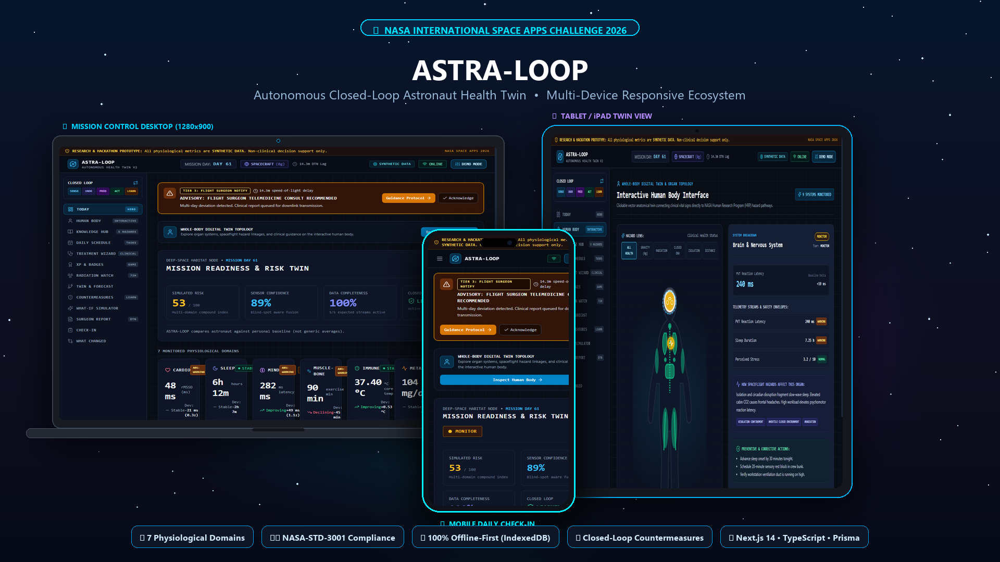

# ASTRA-LOOP v2 🛰️

<div align="center">



### **Autonomous Closed-Loop Astronaut Health Twin & Multi-Hazard Clinical Decision Support System**
*Built for the NASA International Space Apps Challenge 2026*

[](https://astra-loop-health-twin-nasa-space-a.vercel.app/)
[](https://astra-loop-api.onrender.com)
[](https://github.com/ripro805/astra-loop-health-twin-nasa-space-app-challenge-2026)

---

[](https://nextjs.org/)
[](https://www.typescriptlang.org/)
[](https://nodejs.org/)
[](https://prisma.io/)
[](https://sqlite.org/)
[](https://www.nasa.gov/)
[](https://developer.mozilla.org/en-US/docs/Web/API/IndexedDB_API)
[](LICENSE)

</div>

---

## 📑 Table of Contents
- [🌌 The Deep Space Challenge](#-the-deep-space-challenge)
- [✨ Core Capabilities & Innovations](#-core-capabilities--innovations)
- [🌐 Live Deployment Links](#-live-deployment-links)
- [🖥️ Responsive Multi-Device Architecture](#-responsive-multi-device-architecture)
- [🧬 Dual-Layer Safety & Mathematical Model](#-dual-layer-safety--mathematical-model)
- [📊 Telemetry & Biomarker Catalog](#-telemetry--biomarker-catalog)
- [🏗️ System Architecture & Monorepo](#-system-architecture--monorepo)
- [🚀 Quick Start (Local Setup)](#-quick-start-local-setup)
- [🧪 Test Suite](#-test-suite)
- [📚 NASA Data Sources & Evidence Base](#-nasa-data-sources--evidence-base)
- [📜 Medical Disclaimer & License](#-medical-disclaimer--license)

---

## 🌌 The Deep Space Challenge

During extended missions to the Moon (Artemis) or Mars, astronauts face the **5 Hazards of Human Spaceflight** outlined by NASA's Human Research Program (HRP):
1. **Space Radiation** (Galactic Cosmic Rays [GCR] and sporadic Solar Particle Events [SPE])
2. **Isolation & Confinement** (Circadian desynchrony, sleep fragmentation, cognitive slowing)
3. **Distance from Earth** (**14.3 to 22+ minute round-trip speed-of-light communication latency**, completely precluding real-time telemedicine or live Earth flight surgeon consults)
4. **Gravity Fields** ($0g$ microgravity, $0.16g$ Lunar, $0.38g$ Martian bone/muscle deconditioning and cephalad fluid shifts)
5. **Hostile Closed Environments** (Elevated habitat $CO_2$ pooling, acoustic noise, closed-loop atmospheric shifts)

### The Solution: ASTRA-LOOP
**ASTRA-LOOP** is an autonomous, **100% offline-first digital bio-twin** and clinical decision-support engine. It empowers astronauts to independently assess their physiological state, forecast multi-day health risks, resolve clinical ambiguities using NASA-grounded decision trees, apply targeted countermeasures, and automatically evaluate therapeutic recovery via an adaptive **closed-loop feedback loop ("Learn Loop")**.

---

## ✨ Core Capabilities & Innovations

### 1. Interactive Anatomical Health Twin (`/body`)
* **9 Interactive Physiological Systems:** Brain & Nervous System (PVT latency), Ophthalmic (SANS risk), Cardiovascular (HRV & arterial pressure), Respiratory ($CO_2$ ventilatory load), Immune (latent viral reactivation / pyrexia), Metabolic (spaceflight insulin resistance), Musculoskeletal (ARED load), Skeletal (bone resorption), and Integumentary (skin barrier).
* **Dynamic Hazard Lenses:** Instant toggle to visualize physiological stress through the lens of Microgravity ($0g$), Cosmic Radiation, Closed Environment ($CO_2$), Isolation, or Distance.
* **Color-Coded Clinical Triage:** Green (`NORMAL`), Amber (`MONITOR`), Rose/Red (`ATTENTION`).

### 2. Dual-Layer Clinical Safety Engine
* **Layer 1 (Personalized Twin Baseline):** 14-day rolling Exponentially Weighted Moving Average (EWMA) and $Z$-score calculations to detect subtle physiological drift tailored to each astronaut.
* **Layer 2 (NASA-STD-3001 Absolute Floor/Ceiling):** Unconditional safety overrides. Even if a metric drifts gradually, absolute clinical safety thresholds enforce immediate warnings to prevent clinical blind spots.

### 3. Solar Radiation Watch Window (`/radiation`)
* Autonomous detection of Solar Particle Events (SPE).
* Automatically initiates an active **72-hour clinical observation window**, correlating acute ionizing radiation dose spikes with heart rate variability (HRV), cognitive reaction latency (PVT), and sleep efficiency.
* Tracks cumulative career dose against NASA lifetime limits (600 mSv).

### 4. Closed-Loop Countermeasure Engine & Learn Loop (`/countermeasures`)
* Prescribes targeted, non-pharmacological and pharmacological countermeasures (e.g., ARED resistance loading, blue-enriched light therapy, electrolyte fluid loading, melatonin re-timing).
* **The Learn Loop:** Periodically re-evaluates the astronaut's biometrics to calculate an empirical effect delta ($Z$-score improvement) and updates countermeasure confidence rankings.

### 5. What-If Predictive Simulation Sandbox (`/what-if`)
* Allows crew members to test clinical scenarios before taking action:
  * *"What happens if I miss 2 hours of sleep and cabin $CO_2$ rises to 3,000 ppm?"*
  * *"How much exercise loading offsets a 3-day microgravity cardio deconditioning trend?"*
* Visualizes projected 7-day risk trajectories across Cardiovascular, Fatigue, and Recovery domains.

### 6. Interactive Decision Trees & Ground Transmission Packets (`/guidance`)
* Step-by-step clinical guidance wizard for common spaceflight pathologies (acute hypertension, circadian disruption, $CO_2$ headaches, viral reactivations).
* Prepares delay-tolerant structured medical telemetry packets ready for downlink to Earth Mission Control when communication windows open.

### 7. Delay-Tolerant Networking (DTN) & 100% Offline-First Architecture
* Complete client-side **IndexedDB buffer**. All check-ins, routine tasks, and clinical actions persist locally during complete RF blackouts.
* Seamless background synchronization when communication links are restored.

---

## 🌐 Live Deployment Links

| Service | Platform | URL | Status |
| :--- | :--- | :--- | :--- |
| **Frontend Web App** | Vercel (Edge) | [astra-loop-health-twin-nasa-space-a.vercel.app](https://astra-loop-health-twin-nasa-space-a.vercel.app/) |  |
| **Backend API** | Render.com | [astra-loop-api.onrender.com](https://astra-loop-api.onrender.com) |  |
| **Source Code** | GitHub | [ripro805/astra-loop-health-twin...](https://github.com/ripro805/astra-loop-health-twin-nasa-space-app-challenge-2026) |  |

> [!NOTE]
> **Render Free Tier Cold Start:** The backend service on Render spins down after inactivity. On your first visit, the API may take 30–50 seconds to boot up. Subsequent requests respond instantly.

---

## 🖥️ Responsive Multi-Device Architecture

ASTRA-LOOP is engineered to run seamlessly across all mission hardware form-factors:

```
┌─────────────────────────────────────────────────────────────────────────────┐
│                       ASTRA-LOOP HARDWARE ECOSYSTEM                         │
├──────────────────────┬─────────────────────────────┬────────────────────────┤
│  💻 LAPTOP / DESKTOP │      📱 TABLET / iPAD       │   📲 MOBILE / WEARABLE │
├──────────────────────┼─────────────────────────────┼────────────────────────┤
│ • Full Mission Ctrl  │ • Bedside Body Twin (/body) │ • Morning Biometrics   │
│ • Trend Analytics    │ • Clinical Decision Wizard  │ • Daily Check-in Log   │
│ • Flight Surgeon Rpt │ • Ultrasound Scan Capture   │ • Offline Queue Cache  │
│ • What-If Sandbox    │ • Countermeasure Ranking    │ • XP & Adherence Track │
└──────────────────────┴─────────────────────────────┴────────────────────────┘
```

---

## 🧬 Dual-Layer Safety & Mathematical Model

### Layer 1: Exponentially Weighted Moving Average (EWMA)
Individual baseline values for each astronaut are continuously updated without being overly skewed by single acute outliers:

$$\bar{x}_t = \alpha \cdot x_t + (1 - \alpha) \cdot \bar{x}_{t-1}$$

The normalized deviation score ($Z$-score) triggers automated status alerts:

$$Z_t = \frac{x_t - \mu_{\text{baseline}}}{\sigma_{\text{baseline}}}$$

* $|Z| \le 1.5$: **STABLE** (Nominal green status)
* $1.5 < |Z| \le 2.5$: **MONITOR** (Sub-clinical deviation warning)
* $|Z| > 2.5$: **ATTENTION** (Significant baseline departure)

### Layer 2: NASA-STD-3001 Absolute Clinical Bounds
To prevent a slowly deteriorating baseline from masking serious danger, absolute physiological floors and ceilings unconditionally override Layer 1:

```
   CRITICAL CEILING  ▲  Systolic BP ≥ 140 mmHg / Core Temp ≥ 38.5°C
   ──────────────────┼─────────────────────────────────────────────
   WARNING BAND      │  Systolic BP 130–139 mmHg / SpO2 < 95%
   ──────────────────┼─────────────────────────────────────────────
   NOMINAL RANGE     │  Personal Baseline ± 1.5 SD (Layer 1 EWMA)
   ──────────────────┼─────────────────────────────────────────────
   WARNING BAND      │  Sleep < 6.0 hrs / HRV rMSSD < 35 ms
   ──────────────────┼─────────────────────────────────────────────
   CRITICAL FLOOR    ▼  SpO2 < 90% / Blood Glucose < 60 mg/dL
```

---

## 📊 Telemetry & Biomarker Catalog

All physiological parameters in ASTRA-LOOP are grounded in spaceflight clinical research and NASA flight standards:

| Biomarker | Flight Hardware Class | Nominal Range | Warning Limit | Critical Threshold | Space Hazard Addressed |
| :--- | :--- | :--- | :--- | :--- | :--- |
| **Systolic BP** | Inflatable Arm Cuff | 90–120 mmHg | $\ge 130$ mmHg | $\ge 140$ mmHg | Fluid Shift / Cardiovascular |
| **Diastolic BP** | Inflatable Arm Cuff | 60–80 mmHg | $\ge 85$ mmHg | $\ge 90$ mmHg | Vascular Resistance Drift |
| **Heart Rate** | Continuous Wearable ECG | 55–80 bpm | $> 95$ or $< 48$ | $> 110$ or $< 42$ | Autonomic Deconditioning |
| **HRV (rMSSD)** | Wearable PPG / Holter | 45–95 ms | $< 35$ ms | $< 25$ ms | Allostatic Stress & Fatigue |
| **Blood Glucose** | Capillary Fingerstick / CGM | 70–100 mg/dL | $> 140$ mg/dL | $> 180$ or $< 60$ | Spaceflight Insulin Resistance |
| **Core Temp** | Tympanic / Temporal Sensor | 36.5–37.2 °C | $\ge 38.0$ °C | $\ge 38.5$ °C | Space Fever / Immune Strain |
| **SpO₂** | Finger Pulse Oximeter | 96–100% | $< 95$% | $< 90$% | Cabin Hypoxia / Lung Function |
| **Cabin CO₂** | Environmental Sensor | 400–2,500 ppm | $> 3,000$ ppm | $> 5,000$ ppm | Hypercapnic Headache & SANS |
| **Sleep Duration** | Actigraphy Watch + Log | 7.0–8.5 hrs | $< 6.0$ hrs | $< 5.0$ hrs | Circadian Misalignment |
| **PVT Latency** | Psychomotor Vigilance Test | 200–250 ms | $> 280$ ms | $> 350$ ms | Cognitive Fatigue / Risk of Error |
| **Radiation Dose** | Active Crew Dosimeter | 0.02–0.08 mSv/h | $> 0.20$ mSv/h | $> 1.00$ mSv/h | SPE Solar Storms & GCR |
| **Exercise Volume** | ARED & T2 Telemetry | 120–150 min/day | $< 60$ min/day | $< 30$ min/day | Musculoskeletal Atrophy |

---

## 🏗️ System Architecture & Monorepo

The project is structured as an enterprise-grade NPM workspaces monorepo:

```
astra-loop-health-twin/
├── apps/
│   ├── api/                     # Node.js Express REST API backend
│   │   ├── prisma/              # Prisma schema & seed migrations (SQLite/PostgreSQL)
│   │   ├── src/
│   │   │   ├── controllers/     # API Route controllers (Health, Astronaut, Guidance, etc.)
│   │   │   ├── engines/         # Decision engines (Threshold, Risk, Forecast, LearnLoop)
│   │   │   ├── routes/          # Express route definitions
│   │   │   ├── services/        # Business logic & database access
│   │   │   └── server.ts        # Server entrypoint
│   │   └── test/                # Vitest test suite (34 passing tests)
│   └── web/                     # Next.js 14 App Router frontend
│       ├── app/                 # Next.js pages (/today, /body, /twin, /guidance, /what-if)
│       ├── components/          # Reusable UI components & interactive SVG body
│       └── lib/                 # IndexedDB client, DTN offline queue & API client
├── packages/
│   └── shared/                  # Shared TypeScript contracts, Zod schemas & knowledge base
├── docs/                        # Clinical documentation, voiceover scripts & screenshots
├── render.yaml                  # Zero-downtime Render deployment specification
└── vercel.json                  # Next.js Vercel root build configuration
```

---

## 🚀 Quick Start (Local Setup)

ASTRA-LOOP is completely pre-configured with a local zero-configuration SQLite database (`file:./dev.db`). No external database server or credentials are required.

### Prerequisites
* Node.js v20 LTS or higher (`node -v`)
* npm v10 or higher (`npm -v`)

### 1. Clone the repository
```bash
git clone https://github.com/ripro805/astra-loop-health-twin-nasa-space-app-challenge-2026.git
cd astra-loop-health-twin-nasa-space-app-challenge-2026
```

### 2. Install dependencies
```bash
npm install
```

### 3. Build shared packages & seed database
```bash
# Build the TypeScript shared knowledge library
npm run build --workspace=packages/shared

# Initialize the local SQLite database & seed 90-day Vance + 120-day Lin mission telemetry
cd apps/api
npx prisma db push
npm run seed
cd ../..
```

### 4. Launch development servers
```bash
# Launches Express API on :4000 and Next.js Web on :3000 concurrently
npm run dev
```

Open [http://localhost:3000](http://localhost:3000) in your browser.

---

## 🧪 Test Suite

ASTRA-LOOP includes an automated unit and integration test suite verifying clinical engines, threshold calculations, and API endpoints:

```bash
# Run Vitest test suite in the API workspace
npm run test --workspace=apps/api
```

```text
 ✓ test/engines.test.ts (34 tests) 142ms
   ✓ ThresholdEngine > evaluates normal readings correctly
   ✓ ThresholdEngine > triggers warning on systolic BP >= 130
   ✓ ThresholdEngine > triggers critical on systolic BP >= 140
   ✓ RiskEngine > computes multidomain weighted risk score
   ✓ EscalationEngine > escalates to CONTACT_FLIGHT_SURGEON upon multi-day trend
   ✓ ForecastEngine > projects 7-day recovery trajectories
   ✓ LearnLoopEngine > updates countermeasure confidence score based on effect delta

 Test Files  1 passed (1)
      Tests  34 passed (34)
   Duration  482ms
```

---

## 📚 NASA Data Sources & Evidence Base

All medical thresholds, flight operational rules, and hazard models in ASTRA-LOOP are grounded in official NASA standards and peer-reviewed aerospace medicine literature:

1. **NASA-STD-3001, Volume 1 (Revision B):** *Crew Health.* National Aeronautics and Space Administration.
2. **NASA-STD-3001, Volume 2 (Revision D):** *Human Factors, Habitability, and Environmental Health.*
3. **NASA Human Research Roadmap (HRR):** *Evidence books on Spaceflight Radiation, Exploration Sleep, and Hypobaric/Hypercapnic environments.*
4. **Spaceflight Reference Stats:** Baseline physiological shift parameters for microgravity cardiovascular deconditioning and SANS ophthalmic progression.
5. Full academic citation links and flight rule mappings are documented in [docs/SOURCES.md](docs/SOURCES.md) and [docs/RISK_MODEL.md](docs/RISK_MODEL.md).

---

## 📜 Medical Disclaimer & License

> [!IMPORTANT]
> **Medical & Operational Disclaimer:**  
> ASTRA-LOOP is an advanced clinical decision-support and educational demonstration system developed for the NASA International Space Apps Challenge 2026. It is designed to demonstrate autonomous healthcare concepts for deep-space missions and is not an FDA-certified Class III medical device. All clinical logic is grounded in open NASA standards and synthetic mission telemetry.

### License
Distributed under the **MIT License**. See `LICENSE` for more information.

---

<div align="center">
Built with ❤️ for the <b>NASA International Space Apps Challenge 2026</b>  
<i>Keeping astronauts safe, resilient, and autonomous across the cosmos. 🌌</i>
</div>
