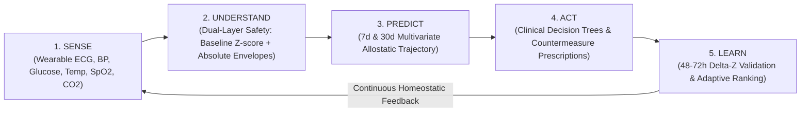
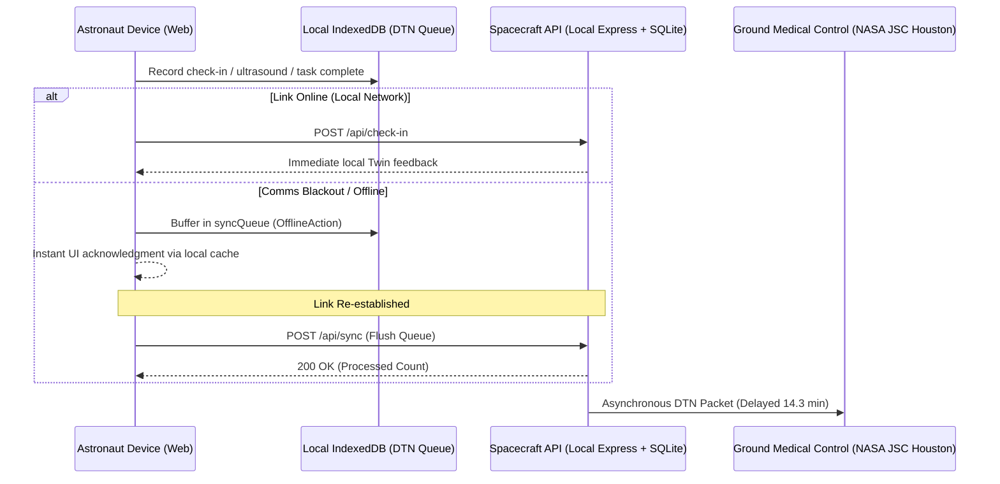

# ASTRA-LOOP v2 — System Architecture & Technical Specifications

**NASA Space Apps Challenge 2026**  
*Autonomous Spaceflight Health Twin & Multi-Hazard Clinical Decision Support System*

---

## 1. Architectural Philosophy

ASTRA-LOOP operates on a safety-critical paradigm designed specifically for deep space exploration missions (Mars Transit, Lunar Base, Martian Surface). Under communication delays ranging from 14.3 to 22.0 minutes one-way (speed-of-light delay), Earth ground flight surgeons cannot provide immediate real-time telemedicine. Astronauts must assess their own health and execute immediate evidence-grounded countermeasures autonomously.



---

## 2. Monorepo Organization & Workspaces

The repository is structured as an npm workspaces monorepo:

```
astra-loop/
├── packages/
│   └── shared/                  # Common TypeScript types, Zod schemas, NASA Knowledge Base
│       ├── src/
│       │   ├── knowledge/       # Mapped indicators, 5 hazards, decision trees, reference stats
│       │   │   ├── indicators.ts
│       │   │   ├── hazards.ts
│       │   │   ├── treatment-trees.ts
│       │   │   └── reference-stats.ts
│       │   └── index.ts         # Central contracts, DTOs, interfaces
├── apps/
│   ├── api/                     # Node.js + Express + Prisma + SQLite backend
│   │   ├── src/
│   │   │   ├── engines/         # Pure biomedical & clinical math engines
│   │   │   │   ├── threshold.engine.ts
│   │   │   │   ├── risk.engine.ts
│   │   │   │   ├── confidence.engine.ts
│   │   │   │   ├── forecast.engine.ts
│   │   │   │   ├── learnLoop.engine.ts
│   │   │   │   ├── baseline.engine.ts
│   │   │   │   ├── radiationWatch.engine.ts
│   │   │   │   ├── environment.engine.ts
│   │   │   │   ├── gravity.engine.ts
│   │   │   │   ├── isolation.engine.ts
│   │   │   │   ├── treatment.engine.ts
│   │   │   │   ├── escalation.engine.ts
│   │   │   │   ├── nutrition.engine.ts
│   │   │   │   ├── gamification.engine.ts
│   │   │   │   └── scheduler.engine.ts
│   │   │   ├── controllers/     # Express HTTP handlers
│   │   │   ├── services/        # Astronaut, Space Weather, Demo, Health services
│   │   │   └── routes/          # Express route definitions
│   │   └── test/                # Unit & Integration test suite (Vitest + Supertest)
│   └── web/                     # Next.js 14 App Router + Tailwind CSS + Recharts
│       ├── app/
│       │   ├── page.tsx         # Landing Page & 5 Hazards Overview
│       │   ├── today/           # Mission Control Hero Dashboard (7 Domains)
│       │   ├── body/            # Whole-Body Clickable Interactive Figure (SVG)
│       │   ├── learn/           # NASA Knowledge Hub & Clinical Procedures
│       │   ├── routine/         # Daily Measurement Checklist & Ultrasound
│       │   ├── guidance/        # Interactive Clinical Treatment Wizard
│       │   ├── progress/        # Gamification, XP, Streaks & Badges
│       │   ├── radiation/       # 72h SPE Horizon & Live NOAA Space Weather
│       │   ├── twin/            # Autonomic Personal Twin & Forecast Cone
│       │   ├── countermeasures/ # Learn Loop Adaptive Ranking History
│       │   ├── what-if/         # Multidimensional Scenario Simulator
│       │   ├── report/          # Flight Surgeon Consolidated Telemetry Dossier
│       │   └── check-in/        # Daily Subjective & Vitals Entry
│       ├── components/          # Modular UI widgets
│       └── lib/
│           ├── api.ts           # API client with fallback & offline hooks
│           └── indexeddb.ts     # Delay-Tolerant Networking (DTN) IndexedDB queue
```

---

## 3. The 5 NASA HRP Hazards Mapped Across 7 Physiological Domains

| NASA HRP Hazard | Key Environmental Telemetry | Targeted Organ Systems | Primary Physiological Biomarkers |
| :--- | :--- | :--- | :--- |
| **Space Radiation** | Dosimeter rate ($mSv/h$), NOAA proton flux ($>10 MeV$) | Bone marrow, immune lymphocytes, lens, vascular endothelium | Cytokine shifts, DNA strand breakage, delayed autonomic recovery |
| **Isolation & Confinement** | Crew interaction minutes, acoustic noise ($dBA$), mission phase | Brain, neuroendocrine axis, circadian sleep centers | PVT reaction latency ($ms$), sleep efficiency, voice acoustic cadence |
| **Distance from Earth** | Comms delay (14.3m one-way), autonomy level | Autonomous crew health management | Decision trees, local DTN buffering, non-reliance on real-time ground |
| **Gravity Fields** | $0.0g$ (Transit/ISS), $0.16g$ (Moon), $0.38g$ (Mars) | Cardiovascular baroreceptors, trabecular bone, postural muscle | Systolic BP ($mmHg$), resting HR, bone mineral resorption ($Ca^{2+}$) |
| **Hostile Closed Environment** | Cabin $CO_2$ ($ppm$), temperature ($^\circ C$), humidity ($\%$) | Respiratory, cerebral circulation, skin microbiome | Hypercapnic headache, dyspnea, pyrexia core temp ($^\circ C$) |

---

## 4. Dual-Layer Safety Override Logic

A critical flaw in purely statistical personal-baseline algorithms is that an astronaut slowly drifting into chronic pathology (e.g. chronic hypertension or hypercapnia) would establish an abnormal personal baseline, causing a dangerous clinical reading to show as "green".

ASTRA-LOOP resolves this with **Dual-Layer Safety Resolution**:

1. **Layer 1 (Individualized Allostatic Baseline):** Computes $Z$-score against the astronaut's 14-day flight baseline using exponentially weighted moving average ($\alpha = 0.20$):
   $$Z = \frac{x_t - \mu_{\text{baseline}}}{\sigma_{\text{baseline}}}$$
2. **Layer 2 (Absolute Clinical Safety Envelope):** Checks absolute thresholds defined in NASA-STD-3001 and AHA/ACC aerospace guidelines:
   - Systolic BP: Warning at $\ge 130$ mmHg, Critical at $\ge 140$ mmHg.
   - Cabin $CO_2$: Warning at $> 3,000$ ppm, Critical at $> 5,000$ ppm (SMAC 1-hr limit).
   - Core Temp: Warning at $\ge 38.0^\circ C$, Critical at $\ge 38.5^\circ C$.
   - Blood Glucose: Warning at $> 140$ mg/dL (fasting $> 100$), Critical at $> 180$ mg/dL or $< 60$ mg/dL.
   - $SpO_2$: Warning at $< 95\%$, Critical at $< 90\%$.

**Rule:** Layer 2 unconditionally overrides Layer 1. If an absolute threshold is breached, the domain status is forced to `ATTENTION` or `MONITOR`, triggering the persistent `EscalationBanner`.

---

## 5. Delay-Tolerant Networking (DTN) Architecture



