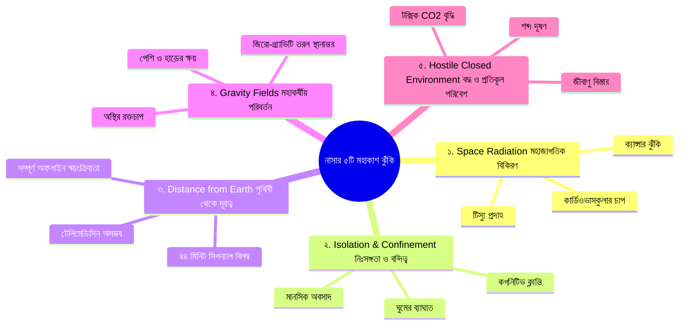
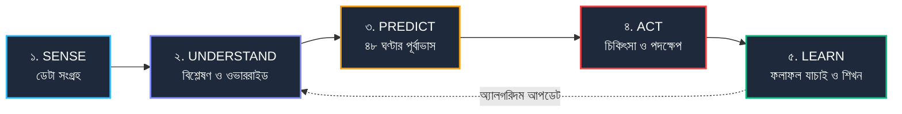

# ASTRA-LOOP: প্রজেক্ট পরিচিতি ও সারসংক্ষেপ
> **নথি ক্রম:** ০১ | **বিষয়:** প্রজেক্ট কী, কেন এবং কার জন্য? | **টার্গেট অডিয়েন্স:** যে কেউ (নতুন শিক্ষার্থী থেকে বিচারক)

---

## এই অংশে যা শিখবেন
* ASTRA-LOOP প্রজেক্টটি কী এবং কেন এটি প্রচলিত ফিটনেস অ্যাপ বা ড্যাশবোর্ড থেকে সম্পূর্ণ আলাদা।
* মঙ্গল বা দূর মহাকাশ অভিযানে পৃথিবী থেকে তাৎক্ষণিক ডাক্তার পাওয়া কেন অসম্ভব (২২ মিনিটের সিগন্যাল লেটেন্সি)।
* নাসার (NASA) চিহ্নিত **৫টি প্রধান মহাকাশ ঝুঁকি (The 5 HRP Hazards)** এবং সেগুলোর সহজ বাস্তব উদাহরণ।
* আমাদের **৫ ধাপের ক্লোজড-লুপ (Sense → Understand → Predict → Act → Learn)** সিস্টেম কীভাবে কাজ করে।
* নাসা স্পেস অ্যাপস চ্যালেঞ্জ ২০২৬-এর প্রতিটি চাহিদার সাথে এই অ্যাপের নিখুঁত মেলবন্ধন।

---

## ১. এক নজরে ASTRA-LOOP (Elevator Pitch)

### ১ লাইনে প্রজেক্ট কী?
> **ASTRA-LOOP** হলো দূর মহাকাশ অভিযানের মহাকাশচারীদের জন্য একটি স্বয়ংক্রিয় অফলাইন ডিজিটাল টুইন (Digital Twin) ও স্বাস্থ্য সহকারী, যা পৃথিবী থেকে চিকিৎসকের সহায়তা ছাড়াই তাদের শারীরিক ও মানসিক ঝুঁকি আগেভাগে শনাক্ত করে জীবন রক্ষাকারী সমাধান দেয়।

### ৩০ সেকেন্ডের ব্যাখ্যা
কল্পনা করুন, আপনি মঙ্গল গ্রহের পথে একটি মহাকাশযানে আছেন। পৃথিবী এত দূরে যে একটি মেসেজ পৃথিবীতে যেতে এবং ডাক্তারের উত্তর ফিরে আসতে প্রায় ৪৫ মিনিট সময় লাগে। এমন সময় যদি আপনার হঠাৎ বুকে চাপ লাগে বা রক্তচাপ বেড়ে যায়, তখন আপনি কার কাছে যাবেন? 
মহাকাশচারীরা সাধারণ ডাক্তার নন। **ASTRA-LOOP** হলো তাদের অন-বোর্ড ভার্চুয়াল স্পেস ফ্লাইট সার্জন। এটি মহাকাশযানের সেন্সর ও মহাকাশচারীর ভাইটালস (HR, BP, গ্লুকোজ, ঘুম, রেডিয়েশন) ট্র্যাক করে, কোনো বিপদ আসার আগেই ভবিষ্যৎবাণী করে এবং ধাপে ধাপে কী ওষুধ বা কাউন্টারমেজার নিতে হবে তা শিখিয়ে দেয়—সম্পূর্ণ ইন্টারনেট ছাড়াই!

### ২ মিনিটের পূর্ণাঙ্গ ব্যাখ্যা
পৃথিবীর বুকে আমরা অসুস্থ বোধ করলে স্মার্টওয়াচ দেখে ডাক্তারের কাছে ছুটে যেতে পারি। কিন্তু পৃথিবী থেকে কোটি কোটি কিলোমিটার দূরে ডিপ-স্পেসে (Deep Space) কোনো হাসপাতাল নেই। তাছাড়া মহাকাশের পরিবেশ পৃথিবীর মতো নয়—সেখানে রয়েছে প্রাণঘাতী মহাজাগতিক বিকিরণ (Radiation), জিরো-গ্র্যাভিটি (Microgravity), নিঃসঙ্গতা ও বদ্ধ বাতাস। 

নাসা স্পেস অ্যাপস চ্যালেঞ্জ ২০২৬-এর মূল আহ্বান ছিল: **"এমন একটি ভিজ্যুয়াল ও ইন্টারঅ্যাক্টিভ ডিজিটাল টুইন টুল তৈরি করা, যা দিয়ে মহাকাশচারীরা নিজেদের স্বাস্থ্য নিজেরা পর্যবেক্ষণ করতে পারবেন এবং সঠিক চিকিৎসা ও স্বাস্থ্যোন্নতির গাইডেন্স পাবেন।"**

বেশিরভাগ স্বাস্থ্য অ্যাপ সাধারণ মানুষের গড় ডেটা (Population Average) দিয়ে কাজ করে। কিন্তু মহাকাশে মানুষের শরীর সম্পূর্ণ বদলে যায়। কারো জন্য ৭০ পালস রেট স্বাভাবিক হলেও, মহাকাশে তরল স্থানান্তরের কারণে তা অস্বাভাবিক হতে পারে। 
ASTRA-LOOP সাধারণ অ্যাপের মতো শুধু চার্ট দেখায় না। এটি একটি **"ক্লোজড-লুপ স্বয়ংক্রিয় সিস্টেম"** তৈরি করে:
১. **Sense:** মহাকাশচারীর প্রতিদিনের ভাইটালস সংগ্রহ করে।
২. **Understand:** মহাকাশচারীর ব্যক্তিগত স্বাভাবিক অবস্থার (Personal Baseline) সাথে তুলনা করে এবং ক্লিনিক্যাল বিপদের সীমা (Clinical Safety Thresholds) দিয়ে বিচার করে।
৩. **Predict:** পরবর্তী ৪৮ ঘণ্টার শারীরিক ঝুঁকি পূর্বাভাস দেয়।
৪. **Act:** মহাকাশচারীকে ইন্টারেক্টিভ ডিসিশন-ট্রি দিয়ে বলে দেয় ঠিক কী কী পদক্ষেপ নিতে হবে।
৫. **Learn:** সেই পদক্ষেপ নেওয়ার পর মহাকাশচারীর উন্নতি হলো কি না তা স্বয়ংক্রিয়ভাবে পরিমাপ করে ভবিষ্যতের জন্য নিজের অ্যালগরিদম আপডেট করে।

---

## ২. মহাকাশে কেন নিজের স্বাস্থ্য নিজেকেই দেখতে হয়?

### সমস্যা ১: দূরত্বের দেয়াল (The Latency Barrier)
চাঁদে গেলে পৃথিবী থেকে রেডিও সিগন্যাল আসতে সময় লাগে মাত্র ১.৩ সেকেন্ড। ডাক্তার টেলিমেডিসিনের মাধ্যমে সরাসরি কথা বলতে পারেন। কিন্তু মঙ্গলে এই দূরত্ব এত বেশি যে আলো বা রেডিও সিগন্যালের গতিতেও এক প্রান্তে পৌঁছাতে **৩ থেকে ২২ মিনিট** সময় লাগে। অর্থাৎ, *"আমার মাথা ঘুরছে, কী করব?"*—এই কথাটি পৃথিবীতে পৌঁছাতে ২২ মিনিট, আর ডাক্তারের উত্তর আসতে আরও ২২ মিনিট। মোট **৪৪ মিনিট** পর উত্তর আসবে! কার্ডিয়াক অ্যারেস্ট বা হঠাৎ রক্তচাপ কমে যাওয়ার মতো জরুরি পরিস্থিতিতে এই ৪৪ মিনিট মানে নিশ্চিত মৃত্যু। তাই মহাকাশযানে এমন একটি স্বয়ংক্রিয় বুদ্ধিমত্তা দরকার যা তাৎক্ষণিক সিদ্ধান্ত দিতে পারে।

### সমস্যা ২: মহাকাশচারীরা সবাই ডাক্তার নন
মিশনের ক্রুরা হলেন অ্যারোস্পেস ইঞ্জিনিয়ার, পাইলট, পদার্থবিদ বা ভূতত্ত্ববিদ। তাদের সাধারণ ফার্স্ট-এইড ট্রেনিং থাকলেও তারা জটিল বায়োমেডিক্যাল সিদ্ধান্ত বা আল্ট্রাসাউন্ড ডায়াগনসিসে বিশেষজ্ঞ নন। জটিল মেডিকেল টার্ম দিয়ে তাদের বিভ্রান্ত করা যাবে না; ইন্টারফেসটি হতে হবে অত্যন্ত সহজ, পরিষ্কার ও স্বয়ংক্রিয়।

---

## ৩. নাসার ৫টি মহাকাশ ঝুঁকি (The 5 NASA HRP Hazards)

নাসার হিউম্যান রিসার্চ প্রোগ্রাম (HRP) মানুষের মহাকাশযাত্রার ৫টি প্রধান ঝুঁকি চিহ্নিত করেছে। ASTRA-LOOP এই পাঁচটি ঝুঁকিকেই গাণিতিক ও শারীরবৃত্তীয়ভাবে মডেল করেছে:

### ১. স্পেস রেডিয়েশন (Space Radiation)
* **বাস্তব উপমা:** পৃথিবীর বায়ুমণ্ডল ও চৌম্বক ক্ষেত্র আমাদের জন্য একটি অদৃশ্য ছাতার মতো কাজ করে। মহাকাশে সেই ছাতা নেই। এটি যেন প্রবল রোদে সানস্ক্রিন ছাড়া সারাদিন মরুভূমিতে দাঁড়িয়ে থাকা, যেখানে মহাজাগতিক রশ্মি শরীরের কোষে ছিদ্র তৈরি করছে।
* **শরীরে কী প্রভাব ফেলে:** কোষের ডিএনএ নষ্ট হয়, রক্তনালী শক্ত হয়ে যায় এবং দীর্ঘমেয়াদে ক্যান্সার ও হৃদরোগের ঝুঁকি তৈরি হয়। তাছাড়া সূর্য থেকে হঠাৎ সোলার স্টর্ম (SPE) এলে তীব্র বিকিরণ ঘটে।
* **ASTRA-LOOP-এ কীভাবে ধরা হয়েছে:** নোয়া (NOAA) স্যাটেলাইটের লাইভ প্রোটন ফ্লাক্স ট্র্যাক করা হয়, ৭২ ঘণ্টার কিউমুলেটিভ রেডিয়েশন ওয়াচ উইন্ডো চালানো হয় এবং কার্ডিয়াক চাপের সাথে রেডিয়েশনের সম্পর্ক হিসাব করা হয়।

### ২. আইসোলেশন ও কনফাইনমেন্ট (Isolation & Confinement)
* **বাস্তব উপমা:** একটি ছোট মাইক্রোবাসে ৪-৬ জন মানুষকে যদি টানা ৬ মাস কোনো জানালা না খুলে বন্দি করে রাখা হয়, মানুষের মেজাজ খিটখিটে হবে, ক্লান্তি আসবে এবং নিজেদের মধ্যে মনোমালিন্য হবে।
* **শরীরে কী প্রভাব ফেলে:** শরীরের স্বাভাবিক বায়োলজিক্যাল ঘড়ি (সার্কাডিয়ান রিদম) নষ্ট হয়, ঘুম ভেঙে যায়, মেজাজ খারাপ হয় এবং রিঅ্যাকশন টাইম কমে যায়।
* **ASTRA-LOOP-এ কীভাবে ধরা হয়েছে:** ক্রু সোশ্যাল ইন্টারঅ্যাকশন ট্র্যাকিং, ডেইলি পিভিটি (Psychomotor Vigilance Test) রিঅ্যাকশন স্পিড পরীক্ষা এবং ভয়েস অডিও অ্যানালাইসিস (Jitter) দিয়ে অবসাদ মাপা হয়।

### ৩. পৃথিবী থেকে দূরত্ব (Distance from Earth)
* **বাস্তব উপমা:** মাঝ সাগরে আটকে পড়া কোনো জাহাজের রেডিও নষ্ট হয়ে গেলে যেমন ক্যাপ্টেনকে নিজের বুদ্ধিতেই সব সিদ্ধান্ত নিতে হয়।
* **শরীরে কী প্রভাব ফেলে:** পৃথিবীতে সাহায্য চেয়ে বসে থাকার সুযোগ নেই; তাৎক্ষণিক গাইডেন্স না পেলে ছোটখাটো অসুখও প্রাণঘাতী হয়ে ওঠে।
* **ASTRA-LOOP-এ কীভাবে ধরা হয়েছে:** পুরো সফটওয়্যারটি **১০০% অফলাইন-ফার্স্ট**। ক্লাউডের কোনো প্রয়োজন নেই। মহাকাশযানের নিজস্ব সার্ভারে সব সিদ্ধান্ত তৈরি হয় এবং পৃথিবী সংযোগ পেলে স্বয়ংক্রিয়ভাবে ডেটা সিঙ্ক (DTN Sync) হয়।

### ৪. গ্র্যাভিটি ফিল্ড বা পরিবর্তনশীল অভিকর্ষ (Gravity Fields)
* **বাস্তব উপমা:** একটি পানির বোতল উল্টো করে ধরলে যেমন সব পানি মুখে এসে জমা হয়, মহাকর্ষ না থাকায় পায়ের রক্ত ও তরল মানুষের মাথায় উঠে যায় (Puffy Face syndrome)।
* **শরীরে কী প্রভাব ফেলে:** শরীরের হাড় ভাববে তার ওজন নেওয়ার কোনো দরকার নেই, ফলে প্রতিদিন হাড়ের ক্যালসিয়াম প্রস্রাবের সাথে বের হয়ে হাড় ফাঁপা হয়ে যায়। পেশি শুকিয়ে যায়।
* **ASTRA-LOOP-এ কীভাবে ধরা হয়েছে:** অ্যাপে ৫টি মহাকর্ষ মোড আছে—স্পেসক্রাফট ($0\text{ g}$), মুন বেস ($0.16\text{ g}$), মার্স বেস ($0.38\text{ g}$)। অভিকর্ষ পরিবর্তনের সাথে সাথে অ্যাপটি হাড় ও পেশির ক্ষয়ের ঝুঁকি নিজে থেকেই পুনর্গণনা করে।

### ৫. প্রতিকূল বদ্ধ পরিবেশ (Hostile Closed Environment)
* **বাস্তব উপমা:** একটি ছোট ঘরে সব দরজা-জানালা বন্ধ করে ১০ জন মানুষ দীর্ঘক্ষণ শ্বাস নিলে যেমন ঘরের বাতাস ভারী হয়ে মাথাব্যথা শুরু হয়।
* **শরীরে কী প্রভাব ফেলে:** কার্বন ডাই-অক্সাইড ($\text{CO}_2$) সামান্য বাড়লেই মহাকাশচারীদের দৃষ্টি ঝাপসা হয়, মাথা ঘোরে এবং সিদ্ধান্ত নেওয়ার ক্ষমতা কমে যায়।
* **ASTRA-LOOP-এ কীভাবে ধরা হয়েছে:** কেবিন $\text{CO}_2$ (ppm), তাপমাত্রা, আর্দ্রতা ও নয়েজ লেভেল সার্বক্ষণিক পর্যবেক্ষণ করে অক্সিজেনের ভারসাম্য ও ভেন্টিলেশন অ্যালার্ট দেওয়া হয়।

---

## ৪. প্রচলিত ফিটনেস অ্যাপ বনাম ASTRA-LOOP: পার্থক্য কোথায়?

| বৈশিষ্ট্য | সাধারণ অ্যাপ (যেমন Apple Health / Fitbit) | ASTRA-LOOP v2 |
| :--- | :--- | :--- |
| **মূল্যায়ন পদ্ধতি** | পৃথিবীর সাধারণ মানুষের গড় সীমা (যেমন: সবার জন্যই BP ১২০/৮০ ভালো)। | **Personal Baseline:** মহাকাশচারীর নিজস্ব অভিযোজিত স্বাভাবিক অবস্থার সাথে তুলনা ($Z$-score)। |
| **নিরাপত্তা কৌশল** | শুধুমাত্র একটি নম্বর লাল বা সবুজ দেখায়। | **Dual-Layer Override:** নিজের বেসলাইনের পাশাপাশি NASA-STD-3001-এর কঠোর পরম সীমা প্রয়োগ করে। |
| **অফলাইন সক্ষমতা** | ক্লাউড বা ইন্টারনেটের সাথে যুক্ত না থাকলে কাজ করে না। | **১০০% অফলাইন:** IndexedDB ও লোকাল ইঞ্জিনে মহাকাশযানের ভেতরে স্বয়ংসম্পূর্ণ। |
| **সিদ্ধান্ত প্রক্রিয়া** | শুধুই চার্ট দেখায় (Passive Dashboard)। | **Closed-Loop Action:** "এখনই এই ওষুধ নিন" এবং "কাজ করেছে কি না পরখ করুন"। |
| **মহাকাশ বিজ্ঞান** | শূন্য গ্র্যাভিটি বা রেডিয়েশন চেনে না। | ৫টি মহাকাশ হ্যাজার্ড এবং ভিন্ন ভিন্ন গ্রহের গ্র্যাভিটির নিখুঁত গাণিতিক মডেল। |

---

## ৫. পাঁচ ধাপের স্বয়ংক্রিয় লুপ (The 5-Step Loop)

আমাদের সিস্টেমটি গাড়ির সাধারণ স্পিডোমিটারের মতো নয়, এটি গাড়ির এমন একটি স্বয়ংক্রিয় এআই মেকানিক যা ইঞ্জিন গরম হওয়ার আগেই টের পায়:

1. **Sense (অনুভব করা):** মহাকাশচারীর পালস, রক্তচাপ, রক্তের শর্করা, ঘুমের সময়, কেবিন $\text{CO}_2$ এবং আল্ট্রাসাউন্ড ইমেজ সংগ্রহ করা।
2. **Understand (বোঝা):** সংগৃহীত ডেটা মহাকাশচারীর আগের ৩০ দিনের স্বাভাবিক গড় মানের চেয়ে কতটা বিচ্যুত তা বের করা ($Z$-score)। যদি রক্তচাপ опасনক সীমায় পৌঁছায়, তবে তাৎক্ষণিক লাল সতর্কতা দেওয়া।
3. **Predict (ভবিষ্যদ্বাণী করা):** আগামী ৪৮ ঘণ্টার মধ্যে হার্ট রেট বা ডিহাইড্রেশনের ট্রেন্ড কোন দিকে যাবে তা সিমুলেট করা।
4. **Act (করণীয় নির্ধারণ):** মহাকাশচারীকে বলা—*"আজ ৬০ মিনিট সাইক্লিং করুন, ৫০০ মিলি ইলেক্ট্রোলাইট সলিউশন পান করুন এবং কেবিনের এয়ার-স্ক্রাবার লেভেল-২ তে দিন।"*
5. **Learn (শেখা):** ৩ দিন পর অ্যাপটি আবার ডেটা মেপে দেখে—*"এই পরামর্শে কি মহাকাশচারীর অবস্থার উন্নতি হয়েছে?"* যদি উন্নতি হয়, তবে এই চিকিৎসাকে **PROMISING** হিসেবে রেকর্ড করে, যাতে ভবিষ্যতে একই সমস্যায় এটি আগে প্রয়োগ করা যায়।

---

## ৬. নাসা চ্যালেঞ্জের চাহিদা বনাম আমাদের সমাধান

| নাসা চ্যালেঞ্জের অফিশিয়াল রিকোয়ারমেন্ট | ASTRA-LOOP-এ কীভাবে বাস্তবায়ন করা হয়েছে |
| :--- | :--- |
| **রক্তচাপ, পালস, ব্লাড সুগার, তাপমাত্রা ও ঘুম ট্র্যাক করা** | ১৬টি ভাইটালস সহ ৭টি মেডিকেল ডোমেইন (কার্ডিও, মেটাবলিক, ইমিউন, নার্ভাস ইত্যাদি) তৈরি। |
| **ইন্টারঅ্যাক্টিভ ও ভিজ্যুয়াল মানবদেহ (Clickable Body)** | ভেক্টর এসভিজি মানবদেহ, যাতে ৯টি অর্গান স্পর্শ করে রিয়েল-টাইম স্বাস্থ্য ও হ্যাজার্ড দেখা যায়। |
| **মহাকাশের কোন কোন পরিমাপ সম্ভব ও কেন দরকার তার শিক্ষা** | `/learn` পেজে প্রতিটি টেস্টের ধাপে ধাপে নির্দেশিকা, কারণ ও মহাকাশীয় ঝুঁকি বিশ্লেষণ। |
| **চিকিৎসা ও স্বাস্থ্যোন্নতির গাইডেন্স (Treatments & Guidance)** | `/guidance` পেজে ডিসিশন-ট্রি উইজার্ড এবং ৪ স্তরের এসকেলেশন ব্যবস্থা। |
| **ভিন্ন ভিন্ন মহাকাশ পরিবেশের সাপোর্ট** | মহাকাশযান ($0\text{ g}$), স্টেশন, রোভার, চাঁদ ($0.16\text{ g}$) ও মঙ্গল ($0.38\text{ g}$) এনভায়রনমেন্ট সুইচ। |
| **অভ্যাসে পরিণত করতে গেমিফিকেশন ও রুটিন** | সকাল-সন্ধ্যার চেকলিস্ট, স্ট্রিক কাউন্টার, এক্সপি ও নাসা লোর ব্যাজ (ওভার-এক্সারসাইজ সেফটি গার্ডসহ)। |
| **ইমেজ ও আল্ট্রাসাউন্ড ইনপুট** | অন-বোর্ড ক্যামেরা ও আল্ট্রাসাউন্ড স্ক্যানার মডিউল এবং ক্যানভাস ড্রয়িং মার্কআপ। |

---

> [!TIP]
> **মনে রাখুন:** ASTRA-LOOP হলো মহাকাশচারীর জন্য একটি "সেকেন্ড ব্রেন" (Second Brain)। এটি মহাকাশচারীর ওপর অতিরিক্ত মানসিক চাপ দেয় না, বরং তাদের শান্ত রেখে ধাপে ধাপে সুস্থ রাখে।
