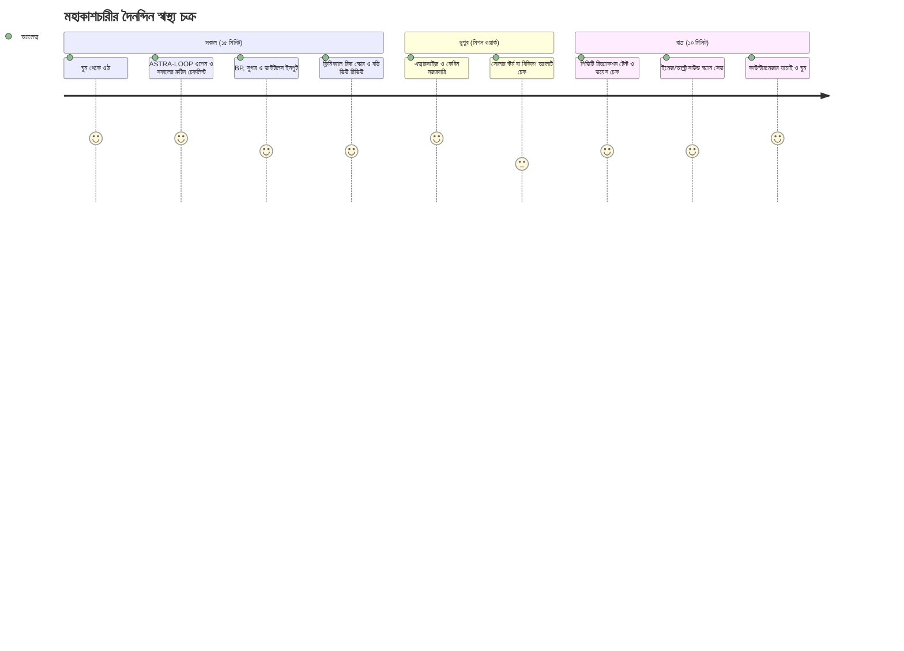
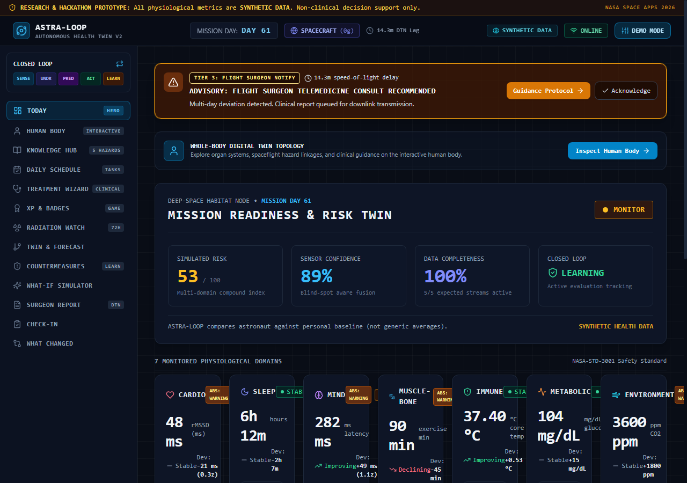
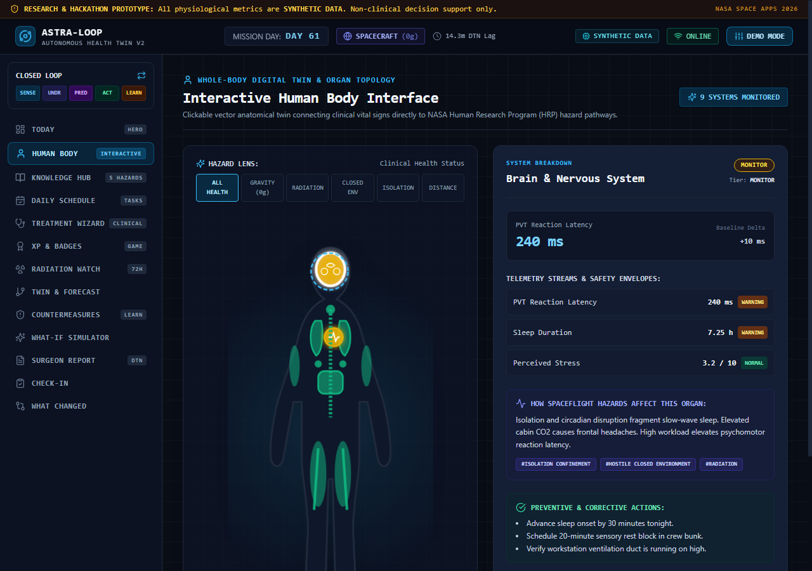
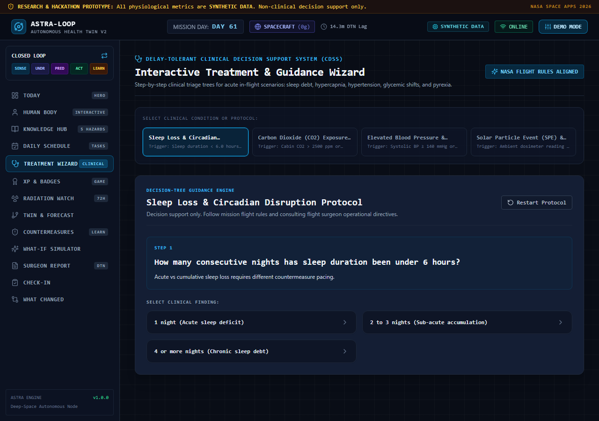
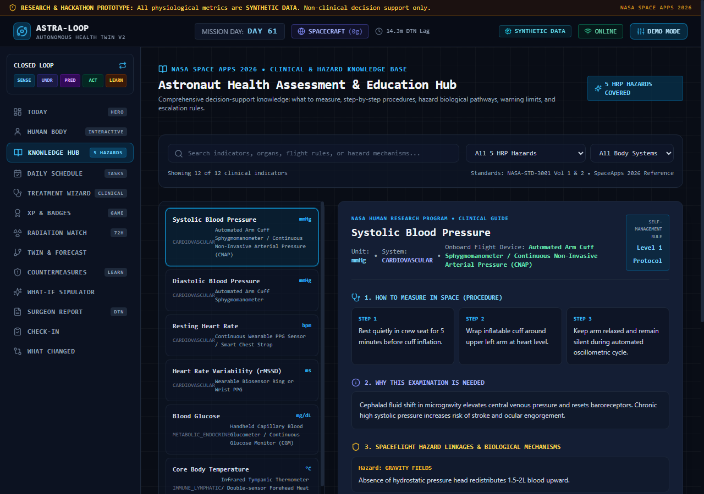
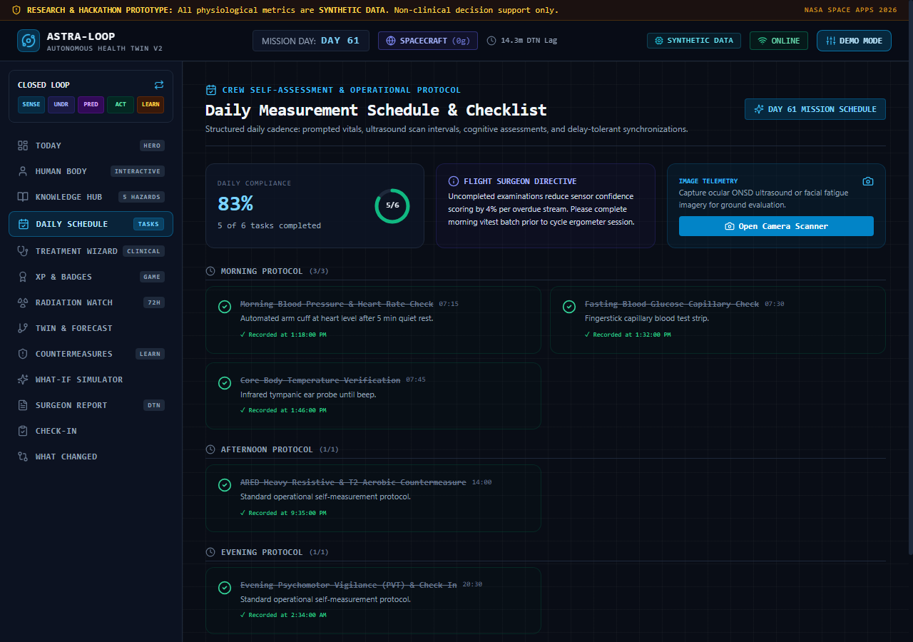
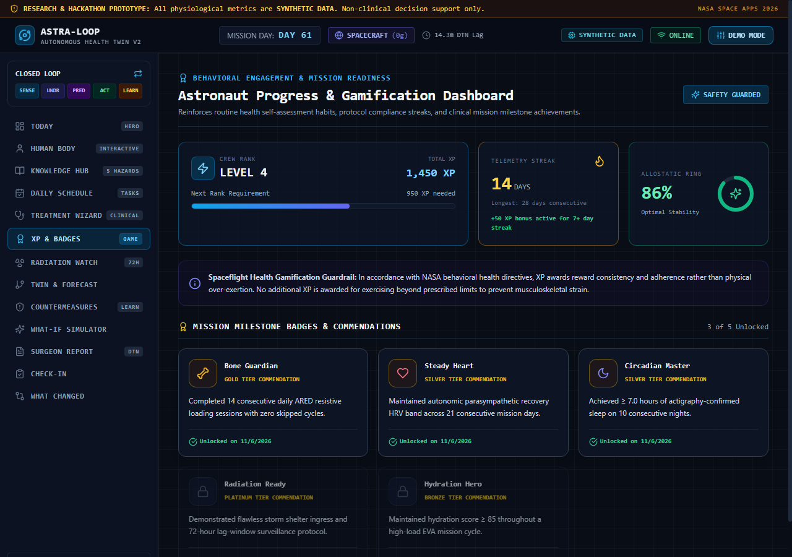
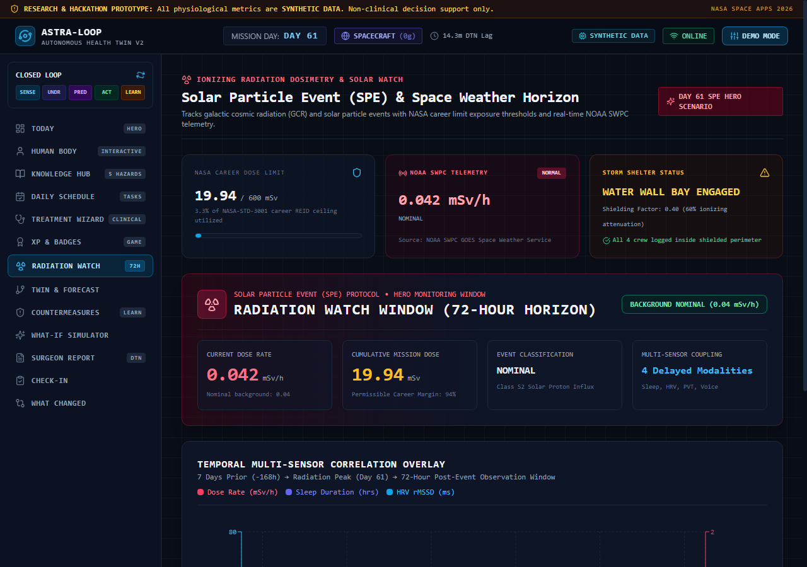
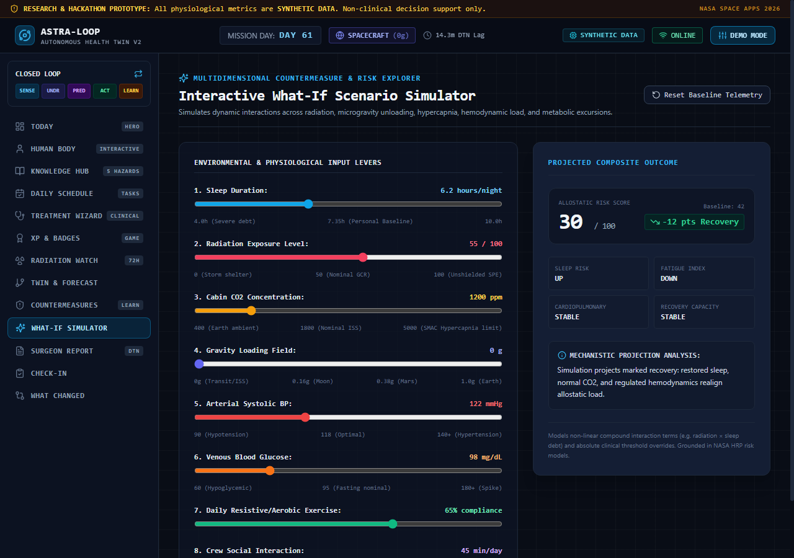
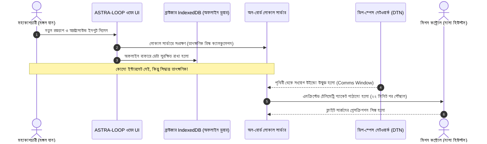

# ASTRA-LOOP: মহাকাশে কীভাবে ব্যবহার করবেন (অ্যাস্ট্রোনট ম্যানুয়াল)
> **নথি ক্রম:** ০২ | **দৃষ্টিভঙ্গি:** মহাকাশচারীর চোখে বাস্তব দিনযাপন ও ইন্টারফেস গাইড

---

## এই অংশে যা শিখবেন
* একজন মহাকাশচারী কীভাবে ঘুম থেকে উঠে প্রতিদিন এই অ্যাপ ব্যবহার করেন ("A Day in the Life")।
* অ্যাপের প্রতিটি পেজের ইন্টারফেস, বাটন এবং স্ক্রিনশটের সহজ ব্যাখ্যা।
* সবুজ, হলুদ, কমলা ও লাল রঙের অর্থ এবং তখন আপনার কী পদক্ষেপ নেওয়া উচিত।
* ৪টি এসকেলেশন টিয়ার (কখন নিজে সমাধান করবেন আর কখন পৃথিবীতে জরুরি মেসেজ পাঠাবেন)।
* ৫টি বাস্তব মহাকাশীয় সংকট এবং ধাপে ধাপে তা মোকাবিলার পদ্ধতি।

---

## ১. মহাকাশে একদিন: ৬১তম দিনের একটি বাস্তব গল্প

**তারিখ:** মঙ্গল অভিযানের ৬১তম মিশন ডে (Sol 61)  
**অবস্থান:** ডিপ-স্পেস ট্রানজিট ভেহিক্যাল (Deep Space Transit Vehicle), পৃথিবী থেকে ৪.২ কোটি কিমি দূরে  
**মহাকাশচারী:** কমান্ডার অ্যালেক্স ভ্যান্স (CDR Alex Vance)

সকাল ০৬:০০ টা (UTC)। মহাকাশযানের মৃদু স্লিপ-পডের অ্যালার্মে অ্যালেক্সের ঘুম ভাঙল। জিরো-গ্র্যাভিটিতে স্লিপিং ব্যাগে শরীর ভাসছে। মুখটা কিছুটা ফোলা ফোলা লাগছে—মহাকাশের সাধারণ "ফ্লুইড শিফট" (Fluid Shift), যেখানে রক্তের জলীয় অংশ পায়ের দিক থেকে বুকে ও মুখে উঠে আসে। 

অ্যালেক্স স্লিপ পড থেকে বেরিয়ে ওয়াল-মাউন্টেড টাচপ্যাডে **ASTRA-LOOP** অ্যাপটি চালু করলেন। অ্যাপটি অফলাইনে মহাকাশযানের লোকাল সার্ভার থেকে সেকেন্ডের মধ্যে খুলে গেল।

---

## ২. প্রতিদিনের সময়সূচি ও রুটিন

| সময় | সময়কাল | করণীয় কাজ | কোথায় ইনপুট দেবেন |
| :--- | :--- | :--- | :--- |
| **সকাল ০৬:১৫** | ১০-১২ মিনিট | ১. ডিজিটাল স্কেলে ওজন ও হাইড্রেশন মাপুন। ২. ব্লুটুথ কাফ দিয়ে রক্তচাপ ও পালস নিন। ৩. গ্লুকোমিটার স্ট্রিপে রক্তের শর্করা চেক করুন। | [`/routine`](file:///docs/screenshots/routine.png) (সকালের চেকলিস্ট) |
| **সকাল ০৬:৩০** | ৩ মিনিট | টুডে ড্যাশবোর্ড ([`/today`](file:///docs/screenshots/dashboard-v2.png)) এবং হিউম্যান বডি ([`/body`](file:///docs/screenshots/body-view.png)) দেখে নিন। কোনো লাল বা হলুদ সতর্কতা আছে কি না। | [`/today`](file:///docs/screenshots/dashboard-v2.png) |
| **দুপুর ১৩:০০** | ৫ মিনিট | হাইড্রেশন প্যাক পান করে লগ করুন। কেবিনের $\text{CO}_2$ লেভেল ঠিক আছে কি না দেখে নিন। | [`/today`](file:///docs/screenshots/dashboard-v2.png) |
| **রাত ২১:০০** | ৮-১০ মিনিট | ১. সাইকোমোটর ভিজিল্যান্স টেস্ট (PVT) দ্রুত রিঅ্যাকশন বাটন চাপুন। ২. ৫ সেকেন্ড ভয়েস রেকর্ড করে ক্লান্তি পরিমাপ করুন। ৩. কোনো সমস্যা থাকলে উইজার্ড ([`/guidance`](file:///docs/screenshots/guidance-wizard.png)) অনুসরণ করে ওষুধ/কাউন্টারমেজার নিন। | [`/check-in`](file:///docs/screenshots/dashboard-mobile.png) |

---

## ৩. প্রতিটি স্ক্রিনের ভিজ্যুয়াল গাইড

### ১. টুডে ড্যাশবোর্ড (`/today`)

* **কী দেখতে পাবেন:**
  1. **টপ রিস্ক স্কোর (Composite Risk Score):** একটি বড় গোল গেজে আপনার সামগ্রিক ঝুঁকি (০ থেকে ১০০%) দেখায়।
  2. **কনফিডেন্স মিটার (Confidence Meter):** অ্যাপের ডেটা কতটা নির্ভরযোগ্য (যেমন: ৯২% কনফিডেন্স)। কোনো সেন্সর কাজ না করলে এই স্কোর কমে যায়।
  3. **৭টি মেডিকেল ডোমেইন কার্ড:** Cardiovascular (হৃদযন্ত্র), Autonomic/Sleep (ঘুম), Muscle-Bone (পেশি ও হাড়), Immune (রোগ প্রতিরোধ), Metabolic/Nutrition (পুষ্টি ও শর্করা), Environment (কেবিন বাতাস), এবং Neuro-Behavioral (মানসিক স্থিতি)।
  4. **এসকেলেশন ব্যানার:** কোনো ভাইটাল সীমা ছাড়ালে সবার উপরে লাল বা কমলা ব্যানারে তৎক্ষণাৎ সতর্কতা জ্বলে ওঠে।

### ২. ক্লিকএবল মানবদেহ ও অর্গান সিস্টেম (`/body`)

* **কী দেখতে পাবেন:**
  * একটি চমৎকার ডিজিটাল ভেক্টর মানবদেহ। ৯টি অর্গান স্পর্শযোগ্য: **ব্রেন, চোখ (SANS), থাইরয়েড, হার্ট, ফুসফুস, লিভার ও মেটাবলিজম, কিডনি ও হাইড্রেশন, পেশি ও হাড়, এবং ত্বক/ইমিউন**।
  * যে অঙ্গটি সুস্থ, সেটি শান্ত নীল বা সবুজ রঙে জ্বলবে। যে অঙ্গে চাপ বাড়ছে (যেমন: ডিহাইড্রেশন বা রক্তচাপ বৃদ্ধি), সেটি হলুদ বা লাল রঙে স্পন্দিত (Pulsing Glow) হতে থাকবে।
  * **Hazard Lens (হ্যাজার্ড ফিল্টার):** আপনি চাইলে টপ বাটনে ক্লিক করে দেখতে পারেন—শুধুমাত্র "Radiation" বা "Zero Gravity"-র কারণে শরীরের কোন কোন অঙ্গে সরাসরি চাপ পড়ছে।

### ৩. ক্লিনিক্যাল গাইডেন্স উইজার্ড (`/guidance`)

* **কী দেখতে পাবেন:**
  * মহাকাশচারী যখন অসুস্থ বোধ করেন, এই পেজটি তাকে একজন অভিজ্ঞ চিকিৎসকের মতো প্রশ্ন করে: *"আপনার কি মাথা ব্যথা করছে?"*, *"কেবিনে $\text{CO}_2$ কি ৫০০ ppm-এর বেশি?"*
  * আপনার উত্তরের ওপর ভিত্তি করে এটি ৪টি টিয়ারের একটি প্রেসক্রিপশন তৈরি করে দেয়:
    * **Tier 1 (Self-Manage):** নিজে সমাধান করুন (যেমন: ৩০০ মিলি ইলেক্ট্রোলাইট খান ও ভেন্টিলেশন ফ্যান বাড়ান)।
    * **Tier 2 (Monitor):** আগামী ৪ ঘণ্টা পর পর আবার মাপুন।
    * **Tier 3 (Contact Surgeon):** পৃথিবীর ফ্লাইট সার্জনকে অগ্রাধিকার ভিত্তিতে প্যাকেট পাঠান।
    * **Tier 4 (Emergency):** তাৎক্ষণিক জরুরি প্রটোকল চালু করুন (যেমন: রেডিয়েশন শেল্টারে যান বা অক্সিজেন মাস্ক পরুন)।

### ৪. লার্নিং ও এডুকেশন হাব (`/learn`)

* **কী দেখতে পাবেন:**
  * কীভাবে জিরো-গ্র্যাভিটিতে আল্ট্রাসাউন্ড নিতে হয়, কীভাবে রক্তচাপের কাফ সঠিক অবস্থানে বাঁধতে হয় তার সচিত্র ধাপ।
  * কেন এই টেস্টটি মহাকাশে জরুরি এবং নাসার কোন হ্যাজার্ডের কারণে এই প্যারামিটার বদলে যায়, তার স্পষ্ট বৈজ্ঞানিক ব্যাখ্যা।

### ৫. রুটিন ও ইমেজ ক্যাপচার (`/routine`)

* **কী দেখতে পাবেন:**
  * সকাল ও সন্ধ্যার কাজের পরিষ্কার চেকলিস্ট। কাজ শেষ হলে টিক চিহ্ন দিন।
  * **Image Scanner Modal:** শরীরের কোনো ফুসকুড়ি, চোখের রেটিনা বা আল্ট্রাসাউন্ড স্ক্যান ক্যামেরা দিয়ে ছবি তুলে অ্যাপে যুক্ত করুন। টাচপ্যাডে আঙুল দিয়ে দাগ কেটে চিহ্নিত করতে পারেন (Canvas Drawing Annotation)।

### ৬. প্রোগ্রেস ও গেমিফিকেশন (`/progress`)

* **কী দেখতে পাবেন:**
  * প্রতিদিন নিয়মিত স্বাস্থ্য পরীক্ষার জন্য আপনি **XP (Experience Points)** এবং **লেভেল** অর্জন করবেন।
  * **স্ট্রিক কাউন্টার (Streak):** টানা কতদিন আপনি রুটিন মেনে চলেছেন।
  * **লোর ব্যাজ (Badges):** "Cosmic Shield", "Deep Space Heart", "Martian Pioneer" ইত্যাদি বিশেষ অর্জন আনলক হবে।
  * *মেডিকেল সেফটি লিমিট:* শরীর অসুস্থ বা ক্লান্ত থাকলে অতিরিক্ত ব্যায়াম করে এক্সপি বাড়ানোর চেষ্টা করলে সিস্টেম স্বয়ংক্রিয়ভাবে এক্সপি দেওয়া বন্ধ রাখে, যাতে মহাকাশচারী অতি-পরিশ্রমে বিপদে না পড়েন।

### ৭. রেডিয়েশন ওয়াচ (`/radiation`)

* **কী দেখতে পাবেন:**
  * মহাকাশযানের বাইরের লাইভ সোলার প্রোটন ফ্লাক্স।
  * গত ৭২ ঘণ্টার কিউমুলেটিভ রেডিয়েশন ডোজ (mSv)। যদি নিরাপদ সীমা (যেমন: ২০ mSv) ছাড়িয়ে যায়, তবে এটি সঙ্গে সঙ্গে স্টর্ম অ্যালার্ট দিয়ে ক্রুদের সুরক্ষিত রেডিয়েশন স্টর্ম শেল্টারে (Storm Shelter) আশ্রয় নিতে নির্দেশ দেয়।

### ৮. হোয়াট-ইফ সিমুলেটর (`/what-if`)

* **কী দেখতে পাবেন:**
  * ৯টি স্লাইডার রয়েছে (ঘুম, ব্যায়াম, রেডিয়েশন, কেবিন $\text{CO}_2$, মানসিক চাপ ইত্যাদি)।
  * মহাকাশচারী নিজে স্লাইডার নাড়িয়ে দেখতে পারেন: *"আমি যদি আজ রাতে ২ ঘণ্টা কম ঘুমাই এবং কেবিনের $\text{CO}_2$ বাড়ে, তবে কাল আমার হার্টের ঝুঁকি ও মাথা ব্যথার সম্ভাবনা কত শতাংশ বাড়বে?"*

---

## ৪. স্ট্যাটাস কালার কোড ও আপনার করণীয়

| স্ট্যাটাস রঙ | প্রযুক্তিগত অর্থ | আপনার অনুভূতি | করণীয় পদক্ষেপ |
| :---: | :--- | :--- | :--- |
| **GREEN (স্বাভাবিক)** | $Z$-score স্বাভাবিক ($< 1.0$), সব ভাইটাল ক্লিনিক্যাল রেঞ্জের ভেতরে। | সম্পূর্ণ স্বাভাবিক ও চনমনে। | স্বাভাবিক রুটিন কাজ চালিয়ে যান। |
| **YELLOW (সতর্কতা)** | মাইল্ড বিচ্যুতি ($1.0 \le Z < 2.0$), হালকা পানিশূন্যতা বা ঘুমের ঘাটতি। | হালকা ক্লান্তি বা অস্বস্তি। | হালকা বিশ্রাম নিন, ৫০০ মিলি পানি পান করুন, পরের রুটিন ঠিক রাখুন। |
| **ORANGE (বিপদ বাড়ছে)** | মাঝারি বিচ্যুতি ($2.0 \le Z < 3.0$), রক্তচাপ বা রেডিয়েশন বাড়ছে। | মাথা ভারী, অস্থিরতা বা দৃষ্টিতে চাপ। | `/guidance` উইজার্ড খুলুন, নির্দেশিত ওষুধ/কাউন্টারমেজার নিন। |
| **RED (জরুরি অবস্থা)** | চরম বিচ্যুতি ($Z \ge 3.0$) অথবা **Absolute Safety Threshold** অতিক্রান্ত। | তীব্র অসুস্থতা, মাথা ঘোরা বা বুকে ব্যথা। | **Tier 4 Emergency Protocol:** সরাসরি ক্রু-মেটদের জানান এবং পৃথিবীতে ইমার্জেন্সি প্যাকেট ব্রডকাস্ট করুন। |
| **GRAY (ডেটা নেই)** | সেন্সর বিচ্ছিন্ন বা ডেটা ইনপুট দেওয়া হয়নি। | অজ্ঞাত। | সেন্সর কানেকশন চেক করুন বা ম্যানুয়ালি মেপে ইনপুট দিন। |

---

## ৫. অফলাইন মোড ও ডেটা সিঙ্ক কীভাবে কাজ করে?

* **সহজ উপমা:** এটি যেন আপনার পকেটের একটি অফলাইন নোটবুক। আপনি ইন্টারনেট না থাকলেও নোটবুকে হিসাব লিখে রাখতে পারছেন এবং সেই অনুযায়ী এখনই রান্না বা বাজার করতে পারছেন। পরে যখনই ওয়াইফাই কানেকশন পাবে, নোটবুকটি নিজে থেকেই আপনার গুগল ড্রাইভের সাথে ব্যাকআপ নিয়ে নেবে।

---

## ৬. পাঁচটি বাস্তব দৃশ্যকল্প (Scenarios)

### দৃশ্যকল্প ক: ৩ দিন টানা ঘুমের ঘাটতি ও রিঅ্যাকশন কমে যাওয়া
* **ঘটনা:** মিশনের ৪৮ থেকে ৫০তম দিনে অ্যালেক্স টানা কাজ করার কারণে মাত্র ৪ ঘণ্টা করে ঘুমান।
* **সিস্টেমের আচরণ:** ড্যাশবোর্ডে Autonomic ডোমেইন হলুদ থেকে কমলা হয়ে যায়। পিভিটি টেস্টে রিঅ্যাকশন টাইম ২৫০ মিলিসেকেন্ড থেকে বেড়ে ৪০০ মিলিসেকেন্ড হয়।
* **করণীয়:** সিস্টেম তাকে "Extended Sleep Protocol" সুপারিশ করে এবং ভারী স্পেসওয়াক (EVA) শিডিউল থাকলে তা স্থগিত করতে বলে।

### দৃশ্যকল্প খ: সৌর ঝড় (Solar Particle Event) — ৬১তম দিনের হিরো সিনারিও
* **ঘটনা:** সূর্য থেকে তীব্র প্রোটন ঝড় শুরু হলো। বাইরের বিকিরণ সেন্সরে রেডিয়েশন ডোজ হঠাৎ ০.০৫ থেকে লাফিয়ে ১.৪ mSv/ঘণ্টায় উঠল।
* **সিস্টেমের আচরণ:** পুরো অ্যাপে লাল অ্যালার্ট ব্যানার জ্বলে ওঠে: **"CRITICAL RADIATION EVENT — EVACUATE TO STORM SHELTER"**।
* **করণীয়:** অ্যালেক্স অবিলম্বে মহাকাশযানের গভীর কেন্দ্রে ওয়াটার-শিল্ডেড স্টর্ম শেল্টারে প্রবেশ করেন এবং রেডিও-প্রটেক্টিভ ওষুধ সেবন করেন।

### দৃশ্যকল্প গ: ব্লুটুথ হার্ট-রেট সেন্সর নষ্ট হয়ে যাওয়া
* **ঘটনা:** অ্যালেক্সের হাতের রিস্টব্যান্ড নষ্ট হয়ে গেল, কোনো পালস ডেটা আসছে না।
* **সিস্টেমের আচরণ:** সাধারণ অ্যাপ ক্র্যাশ করত বা শূন্য দেখাত। কিন্তু ASTRA-LOOP এর **Confidence Engine** কাজ শুরু করে। ড্যাশবোর্ডের কনফিডেন্স ১০০% থেকে কমে ৬৮% এ নেমে আসে এবং হার্ট ডোমেইনটি ছাই (GRAY) রঙ ধারণ করে।
* **করণীয়:** সিস্টেম নোটিফিকেশন দেয়: *"হার্ট রেট ডেটা মিসিং। দয়া করে ম্যানুয়ালি গলায় হাত দিয়ে পালস গুনে ইনপুট দিন।"*

### দৃশ্যকল্প ঘ: রক্তচাপ হঠাৎ বিপজ্জনক মাত্রায় বেড়ে যাওয়া (Clinical Excursion)
* **ঘটনা:** সকালে রক্তচাপ মাপার পর দেখা গেল সিস্টোলিক চাপ **১৬৫ mmHg** (স্বাভাবিকের চেয়ে অনেক বেশি)।
* **সিস্টেমের আচরণ:** যদিও মহাকাশে অ্যালেক্সের আগের বেসলাইন কিছুটা বেশি ছিল, কিন্তু ASTRA-LOOP এর **Dual-Layer Threshold Engine** ব্যক্তিগত বেসলাইনকে ওভাররাইড করে সরাসরি আমেরিকান হার্ট অ্যাসোসিয়েশনের (AHA) ক্লিনিক্যাল স্টেজ-২ হাইপারটেনশন লাল সতর্কতা জারি করে।
* **করণীয়:** গাইডেন্স উইজার্ড তাকে নির্দেশ দেয়: অতিরিক্ত সোডিয়াম খাওয়া বন্ধ করুন, ম্যাগনেসিয়াম সাপ্লিমেন্ট নিন এবং ফ্লাইট সার্জনকে অগ্রাধিকার বার্তা পাঠান।

### দৃশ্যকল্প ঙ: কাউন্টারমেজার শুরু করে ফলাফল দেখা (Learn Loop)
* **ঘটনা:** ৬৩তম দিনে অ্যালেক্সের হার্ট ও ঘুমের উন্নতির জন্য দিনে ৪৫ মিনিট সাইক্লিং এবং মেলাটোনিন দেওয়া হলো।
* **সিস্টেমের আচরণ:** ৬৫তম দিনে অ্যাপের **Learn Loop Engine** স্বয়ংক্রিয়ভাবে বিশ্লেষণ করে দেখায় যে তার রিস্ক স্কোর ৪২% কমেছে এবং $Z$-score স্বাভাবিকের দিকে ফিরেছে।
* **ফলাফল:** সিস্টেমে এই কাউন্টারমেজারটি **PROMISING** হিসেবে ব্যাজ পায়, যা ভবিষ্যতে অন্যান্য ক্রুদের জন্যও রেফারেন্স হিসেবে যুক্ত হয়।

