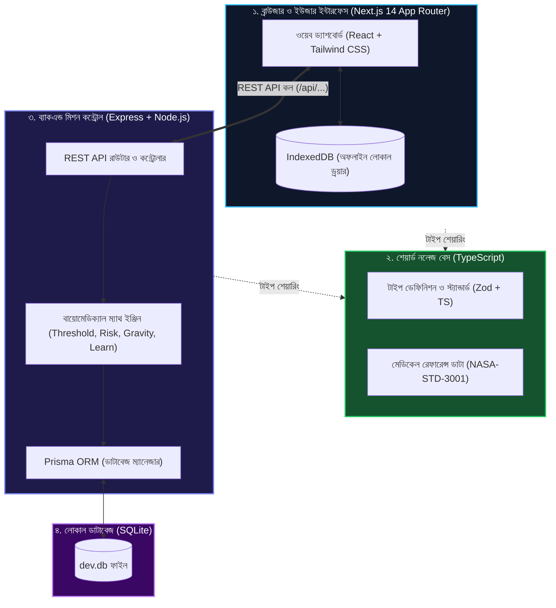
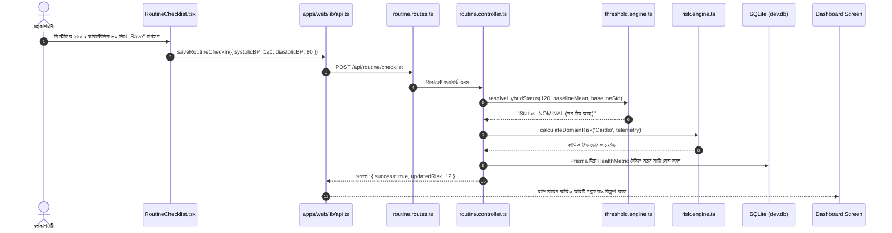
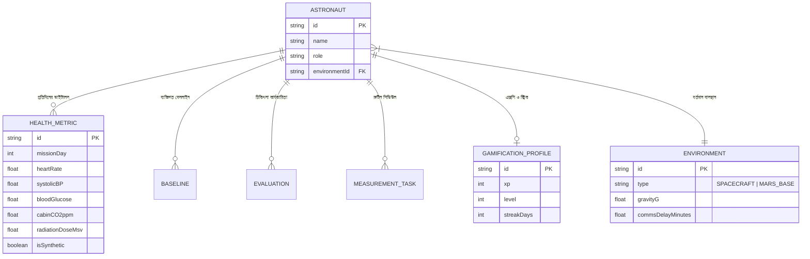

# ASTRA-LOOP: কোড ও আর্কিটেকচার সহজ ভাষায় (Architecture for Non-Coders)
> **নথি ক্রম:** ০৫ | **বিষয়:** সিস্টেম আর্কিটেকচার, ডেটার যাত্রা এবং গণিতের হাতে-কলমে হিসাব | **টার্গেট:** কোডিং না জানা অনুসন্ধিৎসু পাঠক

---

## এই অংশে যা শিখবেন
* পুরো প্রজেক্টের প্রযুক্তিগুলো কীভাবে একসাথে কথা বলে (Next.js $\leftrightarrow$ Express $\leftrightarrow$ Prisma $\leftrightarrow$ SQLite)।
* মহাকাশচারী একটি বাটন চাপলে ডেটা কোন কোন ফাইলের ভেতর দিয়ে কীভাবে ডাটাবেসে যায়।
* প্রতিটি গাণিতিক অ্যালগরিদমের (Z-score, EWMA, Risk Weights, Interaction Term) **বাস্তব সংখ্যাসহ হাতে-কলমে হিসাব**।
* ডাটাবেসের টেবিলগুলোর সম্পর্ক (Entity Relationship Diagram)।
* ভবিষ্যতে আপনি নিজে কীভাবে একটি নতুন স্বাস্থ্য পরীক্ষা বা ফিচার যোগ করবেন।

---

## ১. পুরো সিস্টেমের মানচিত্র (High-Level Architecture)

একটি বড় মহাকাশযান যেমন ইঞ্জিন, কেবিন ও অক্সিজেন প্যাক ছাড়া চলতে পারে না, তেমনি আমাদের অ্যাপটিও ৩টি প্রধান স্তরে বিভক্ত:



### সহজ ভাষায় প্রযুক্তিগুলোর ভূমিকা
1. **Next.js (ফ্রন্টএন্ড):** এটি মহাকাশচারীর চোখের সামনের রঙিন স্ক্রিন, বোতাম ও চার্ট তৈরি করে।
2. **Express (ব্যাকএন্ড এপিআই):** এটি মহাকাশযানের ট্রাফিক পুলিশ। ফ্রন্টএন্ড থেকে আসা অনুরোধ গ্রহণ করে এবং সঠিক ইঞ্জিনের কাছে পাঠায়।
3. **Engines (গণিতের মস্তিষ্ক):** এটি খাঁটি গণিত ও চিকিৎসাবিজ্ঞানের কোড। কোনো ফ্রন্টএন্ড বা ডাটাবেজের ওপর নির্ভরশীল না হয়ে শুধু সংখ্যার হিসাব করে।
4. **Prisma & SQLite (মেমোরি/ডাটাবেজ):** এটি মহাকাশযানের সুরক্ষিত ডিজিটাল খাতা, যেখানে ৯০ দিনের সমস্ত ইতিহাস সেভ থাকে।

---

## ২. ফোল্ডার ম্যাপ (কোন ফোল্ডারে কী আছে?)

| ফোল্ডারের পাথ | কী কাজ করে? (সহজ ব্যাখ্যা) |
| :--- | :--- |
| `packages/shared/` | ফ্রন্টএন্ড ও ব্যাকএন্ড উভয়ের জন্য সাধারণ নিয়ম, টাইপ এবং নাসার মেডিকেল রেফারেন্স ডেটা। |
| `apps/api/src/engines/` | **সবচেয়ে গুরুত্বপূর্ণ ফোল্ডার!** এখানে সব গণিত, ঝুঁকি এবং থ্রেশহোল্ড অ্যালগরিদম রয়েছে। |
| `apps/api/src/controllers/` | এপিআই রিকোয়েস্ট যাচাই করে এবং ইঞ্জিন চালিয়ে ফলাফল ফেরত পাঠায়। |
| `apps/api/src/routes/` | কোন ইউআরএলে (`/api/guidance`, `/api/today`) হিট করলে কোন কোড চলবে তা ঠিক করে। |
| `apps/api/prisma/` | ডাটাবেজ টেবিলের গঠন (`schema.prisma`) এবং ডেমো ডেটা ভরার স্ক্রিপ্ট (`seed.ts`)। |
| `apps/web/app/` | ব্যবহারকারীর পেজগুলো (`/today`, `/body`, `/guidance`, `/routine`, `/progress`, `/report`)। |
| `apps/web/components/` | পুনর্ব্যবহারযোগ্য ভিজ্যুয়াল কম্পোনেন্ট (যেমন ভেক্টর বডি, চার্ট, হেডার, মোডাল)। |
| `docs/` | সায়েন্টিফিক রিসার্চ, এপিআই ডকুমেন্টস, সিদ্ধান্ত নোট ও স্ক্রিনশট। |

---

## ৩. একটি ডেটার যাত্রা (The Journey of a Data Packet)

ধরুন, মহাকাশচারী সকালে তার রক্তচাপ **১২০/৮০** ইনপুট দিলেন। পর্দায় মানটি পরিবর্তনের পেছনের যাত্রাটি দেখুন:



---

## ৪. গণিত ও অ্যালগরিদম: বাস্তব সংখ্যাসহ হাতে-কলমে হিসাব

অনেকে ভাবেন এআই মানেই অনেক জটিল ব্ল্যাকবক্স। কিন্তু চিকিৎসাবিজ্ঞানে জীবন বাঁচাতে প্রয়োজন **ব্যাখ্যাযোগ্য ও স্বচ্ছ গণিত (Explainable Math)**। নিচে আমাদের ফর্মুলাগুলোর বাস্তব হিসাব দেওয়া হলো:

### ক. বেসলাইন ও স্ট্যান্ডার্ড ডেভিয়েশন ($\mu$ এবং $\sigma$)
ধরুন, মহাকাশচারী অ্যালেক্সের আগের ৫ দিনের হৃদস্পন্দন (HR) ছিল:
$$\text{দিন ১: } ৭১, \quad \text{দিন ২: } ৭৩, \quad \text{দিন ৩: } ৭০, \quad \text{দিন ৪: } ৭২, \quad \text{দিন ৫: } ৭৪$$

১. **গড় ($\mu$ বা Mean):**
   $$\mu = \frac{৭১ + ৭৩ + ৭০ + ৭২ + ৭৪}{৫} = \frac{৩৬০}{৫} = ৭২ \text{ bpm}$$

২. **ভেদাঙ্ক ও স্ট্যান্ডার্ড ডেভিয়েশন ($\sigma$):**
   প্রতিটি দিন গড়ের চেয়ে কতটা দূরে:
   * $(৭১ - ৭২)^২ = (-১)^২ = ১$
   * $(৭৩ - ৭২)^২ = (১)^২ = ১$
   * $(৭০ - ৭২)^২ = (-২)^২ = ৪$
   * $(৭২ - ৭২)^২ = (০)^২ = ০$
   * $(৭৪ - ৭২)^২ = (২)^২ = ৪$

   গড় বিচ্যুতি (Variance) $= \frac{১ + ১ + ৪ + ০ + ৪}{৫} = \frac{১০}{৫} = ২$  
   স্ট্যান্ডার্ড ডেভিয়েশন ($\sigma$) $= \sqrt{২} \approx ১.৪১ \text{ bpm}$

* **অর্থ:** অ্যালেক্সের স্বাভাবিক হার্ট রেট হলো **$৭২ \pm ১.৪১$ bpm**।

---

### খ. জেড-স্কোর (Z-Score)
আজ সকালে অ্যালেক্সের হার্ট রেট মাপা হলো **৭৯ bpm**। তিনি কি ঝুঁকিতে আছেন?
$$Z = \frac{\text{আজকের মান} - \mu}{\sigma} = \frac{৭৯ - ৭২}{১.৪১} = \frac{৭}{১.৪১} = +৪.৯৬\sigma$$

* **ব্যাখ্যা:** $Z = +৪.৯৬$ এর অর্থ হলো তিনি তার স্বাভাবিক অবস্থার চেয়ে প্রায় **৫ গুণ স্ট্যান্ডার্ড ডেভিয়েশন দূরে** চলে গেছেন! পরিসংখ্যান অনুযায়ী ৯৯.৭% সময় মান $-৩$ থেকে $+৩$ এর মধ্যে থাকে। $+৪.৯৬$ হওয়া মানে তার শরীরে তাৎক্ষণিক কোনো অস্বাভাবিক চাপ (যেমন তীব্র পানিশূন্যতা বা সৌর বিকিরণ) তৈরি হয়েছে।

---

### গ. এক্সপোনেনশিয়াল ওয়েটেড মুভিং অ্যাভারেজ (EWMA)
প্রতিদিন পুরানো দিনের সব ডেটা নতুন করে যোগ করা ভারী। তাই আমরা ব্যবহার করি EWMA, যার মসৃণকরণ গুণক $\alpha = ০.১৫$:
$$\text{নতুন বেসলাইন} = \alpha \times \text{আজকের মান} + (১ - \alpha) \times \text{পুরানো বেসলাইন}$$

যদি পুরানো বেসলাইন হয় $৭২$ এবং আজকের মান হয় $৭৬$:
$$\text{নতুন বেসলাইন} = (০.১৫ \times ৭৬) + (০.৮৫ \times ৭২) = ১১.৪ + ৬১.২ = ৭২.৬ \text{ bpm}$$
* **সুবিধা:** এটি সাম্প্রতিক দিনের পরিবর্তনকে শান্তভাবে গ্রহণ করে কিন্তু একদিনের সামান্য ভুলে পুরো বেসলাইন নষ্ট করে ফেলে না।

---

### ঘ. কম্পোজিট রিস্ক স্কোর ও ইন্টারঅ্যাকশন টার্ম (Risk Formula)
সামগ্রিক ঝুঁকি কেবল সাধারণ যোগফল নয়। যদি ঘুমহীনতা ও রেডিয়েশন একসাথে ঘটে, তবে তাদের ক্ষতি গুণিতক হারে বাড়ে।

$$\text{Composite Risk} = \sum (W_i \times R_i) + \text{Interaction Penalty}$$

ধরুন:
* কার্ডিও রিস্ক ($R_{\text{Cardio}}$) $= ২০\%$, ওয়েট $W_১ = ০.২৫$ $\rightarrow ০.২৫ \times ২০ = ৫.০$
* ঘুম রিস্ক ($R_{\text{Sleep}}$) $= ৫০\%$, ওয়েট $W_২ = ০.২০$ $\rightarrow ০.২০ \times ৫০ = ১০.০$
* রেডিয়েশন রিস্ক ($R_{\text{Rad}}$) $= ৪০\%$, ওয়েট $W_৩ = ০.২৫$ $\rightarrow ০.২৫ \times ৪০ = ১০.০$
* অন্যান্য ডোমেইনের যোগফল $= ১০.০$

**সাধারণ যোগফল:** $৫ + ১০ + ১০ + ১০ = ৩৫\%$।  
কিন্তু সিস্টেম দেখল মহাকাশচারীর **ঘুম নেই ($R_{\text{Sleep}} > ৩০$)** এবং **রেডিয়েশন বেশি ($R_{\text{Rad}} > ৩০$)**।  
ইঞ্জিন তখন একটি **ইন্টারঅ্যাকশন পেনাল্টি** যোগ করে:
$$\text{Penalty} = \gamma \times (R_{\text{Sleep}} \times R_{\text{Rad}}) = ০.০০১ \times (৫০ \times ৪০) = ২.০\%$$
**চূড়ান্ত রিস্ক স্কোর:** $৩৫\% + ২\% = ৩৭\%$।

---

### ঙ. ডুয়াল-লেয়ার সেফটি ওভাররাইড (Absolute Threshold Layer)
ধরুন একজন মহাকাশচারী মাসের পর মাস হাইপারটেনশনে ভুগছেন। ফলে তার বেসলাইন ধীরে ধীরে বেড়ে গড় হয়ে গেল ১৫০ mmHg। 
আজ সকালে তার প্রেশার ১৫৫ mmHg। 
* **শুধু বেসলাইন দেখলে:** $Z = \frac{১৫৫ - ১৫০}{৫} = +১.০$ (সিস্টেম ভাবত হলুদ বা নিরাপদ)।
* **আমাদের ডুয়াল-লেয়ার ওভাররাইড:**
  [`threshold.engine.ts`](file:///apps/api/src/engines/threshold.engine.ts) কোডে লেখা আছে:
  ```typescript
  if (systolicBP >= 140) {
    return 'CRITICAL_OVERRIDE_RED';
  }
  ```
  বেসলাইন যাই বলুক, আন্তর্জাতিক নাসা স্ট্যান্ডার্ড অনুযায়ী ১৪০ ছাড়ালেই সিস্টেম আনকন্ডিশনালি **RED ALERT** জারি করবে। এটিই হলো ক্লিনিক্যাল নিরাপত্তা।

---

## ৫. ডাটাবেস ডিজাইন (Entity Relationship Diagram)

আমাদের ডাটাবেসের মূল টেবিলগুলোর সম্পর্ক নিচে দেখানো হলো:



---

## ৬. কীভাবে একটি নতুন ইন্ডিকেটর বা ফিচার যোগ করবেন? (টিউটোরিয়াল)

ধরুন, ভবিষ্যতে আপনি অ্যাপে **"লাং ক্যাপাসিটি বা ফুসফুসের ক্ষমতা (Lung Capacity in Liters)"** যোগ করতে চান। মাত্র ৪টি সাধারণ ধাপে এটি করা যায়:

1. **ডাটাবেসে ফিল্ড যোগ করুন:**  
   [`apps/api/prisma/schema.prisma`](file:///apps/api/prisma/schema.prisma) ফাইলে `HealthMetric` মডেলে লিখুন:  
   `lungCapacityLiters Float?`  
   তারপর টার্মিনালে চালান: `npm run prisma:push -w apps/api`।

2. **ক্লিনিক্যাল সীমা নির্ধারণ করুন:**  
   [`packages/shared/src/knowledge/indicators.ts`](file:///packages/shared/src/knowledge/indicators.ts) এ গিয়ে স্বাভাবিক সীমা লিখুন (যেমন: স্বাভাবিক ৪.৫ লিটার, বিপদ ৩.০ লিটারের নিচে)।

3. **থ্রেশহোল্ড ইঞ্জিনে যোগ করুন:**  
   [`apps/api/src/engines/threshold.engine.ts`](file:///apps/api/src/engines/threshold.engine.ts) এ একটি ফাংশন লিখুন যা মান ৩.০ এর নিচে নামলে সতর্কবার্তা দেবে।

4. **ইউআই-তে কার্ড দেখান:**  
   [`apps/web/components/today/DomainCard.tsx`](file:///apps/web/components/today/DomainCard.tsx) এ গিয়ে ফুসফুসের একটি আইকন সহ মানটি প্রদর্শন করুন।
