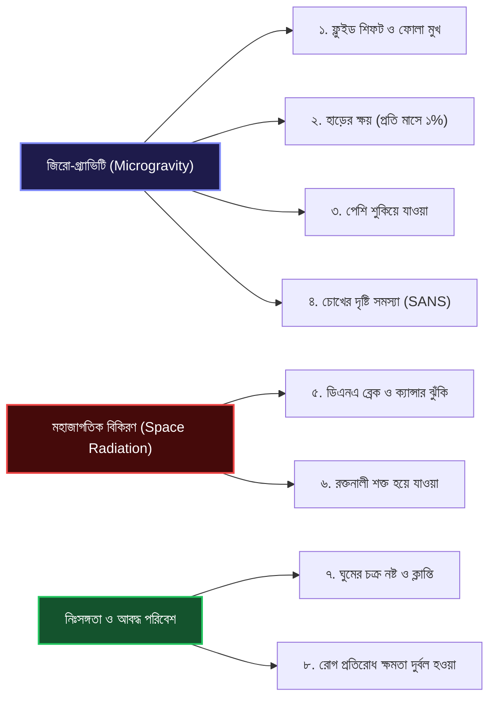

# ASTRA-LOOP: বিজ্ঞান ও মহাকাশ চিকিৎসা প্রাইমার (Space Medicine Primer)
> **নথি ক্রম:** ০৬ | **বিষয়:** মহাকাশে মানবদেহের রূপান্তর, ক্লিনিক্যাল ইন্ডিকেটর ও নাসার প্রমাণ্য স্ট্যান্ডার্ড

---

## এই অংশে যা শিখবেন
* মহাকাশের জিরো-গ্র্যাভিটি ও রেডিয়েশনে মানবদেহের হাড়, পেশি, হার্ট ও চোখের কী কী পরিবর্তন ঘটে।
* ASTRA-LOOP-এ ট্র্যাক করা প্রতিটি স্বাস্থ্য সূচকের (ইন্ডিকেটর) বৈজ্ঞানিক কারণ এবং স্বাভাবিক ও বিপজ্জনক সীমা।
* সৌর ঝড় (Solar Particle Event) এবং মিলিসিভার্ট (mSv) এককে রেডিয়েশন পরিমাপের সহজ ব্যাখ্যা।
* নাসা ও আন্তর্জাতিক স্বাস্থ্য সংস্থার রেফারেন্স সোর্স ও স্ট্যান্ডার্ড।

---

## ১. মহাকাশে মানবদেহে কী ঘটে? (Spaceflight Pathophysiology)

লক্ষ লক্ষ বছর ধরে মানবদেহ পৃথিবীর ১-গ্র্যাভিটি ($1\text{ g}$) এবং সুরক্ষিত বায়ুমণ্ডলের মধ্যে অভিযোজিত হয়েছে। মহাকাশে যাওয়ার পর শরীর মারাত্মক পরিবর্তনের মধ্য দিয়ে যায়:

### ১. তরল স্থানান্তর (Cephalic Fluid Shift — Puffy Face & Bird Legs)
* **ঘটনা:** পৃথিবীতে অভিকর্ষ রক্ত ও পানিকে নিচের দিকে টানে। জিরো-গ্র্যাভিটিতে সেই টান না থাকায় শরীরের নিচের অংশ থেকে প্রায় **১.৫ থেকে ২ লিটার তরল** বুক, ঘাড় ও মাথায় উঠে আসে।
* **লক্ষণ:** মহাকাশচারীর পা পাখির মতো চিকন হয়ে যায় (Bird Legs) এবং মুখমণ্ডল ফুলে ওঠে (Puffy Face)। নাক বন্ধ থাকে এবং রক্তচাপের স্বাভাবিক সেন্সরগুলো বিভ্রান্ত হয়ে পড়ে।

### ২. হাড় ও পেশির দ্রুত ক্ষয় (Bone & Muscle Atrophy)
* **ঘটনা:** পৃথিবীতে হাঁটাচলা করতে আমাদের হাড় ও পেশিকে শরীরের ভার বহন করতে হয়। মহাকাশে কোনো ওজন না থাকায় শরীর মনে করে হাড় ও পেশির আর কোনো প্রয়োজন নেই!
* **ক্ষতি:** প্রতি মাসে মেরুদণ্ড ও পায়ের হাড় থেকে প্রায় **১% খনিজ বা ক্যালসিয়াম ক্ষয়ে যায়** (যা পৃথিবীতে অস্টিওপোরোসিস রোগীর চেয়ে ১০ গুণ দ্রুত)। হাড়ের এই ক্যালসিয়াম রক্ত ও প্রস্রাবে জমা হয়ে কিডনিতে পাথর (Kidney Stone) তৈরি করার ঝুঁকি বাড়ায়।

### ৩. স্পেস ফ্লাইট-অ্যাসোসিয়েটেড নিউরো-অকুলার সিন্ড্রোম (SANS)
* **ঘটনা:** মাথায় তরলের অতিরিক্ত চাপের কারণে চোখের পেছনের অপটিক নার্ভ ফুলে যায় এবং চোখের মণি চ্যাপ্টা হয়ে যায়।
* **লক্ষণ:** মহাকাশচারীদের দূরের ও কাছের দৃষ্টি ঝাপসা হয়ে যায়। মহাকাশে এটি নাসার অন্যতম প্রধান উদ্বেগের বিষয়।

### ৪. মহাজাগতিক বিকিরণ ও ডিএনএ ক্ষতি (Space Radiation)
* **ঘটনা:** গ্যালাকটিক কসমিক রশ্মি (GCR) হলো উচ্চ শক্তিসম্পন্ন প্রোটন ও ভারী আয়ন, যা ধাতব মহাকাশযানের দেয়াল ভেদ করে মানুষের শরীরের কোষে ঢুকে ডিএনএ চেইন ভেঙে দেয় (Double-Strand DNA Breaks)।
* **ক্ষতি:** দীর্ঘমেয়াদে ক্যান্সার, ছানি পড়া এবং রক্তনালীর এন্ডোথেলিয়াল কোষ নষ্ট হয়ে হৃদরোগের সম্ভাবনা বাড়িয়ে দেয়।

---

## ২. প্রতিটি ইন্ডিকেটরের পূর্ণাঙ্গ ক্লিনিক্যাল চার্ট

ASTRA-LOOP যেসব ভাইটালস ট্র্যাক করে, তাদের পূর্ণাঙ্গ চিকিৎসা তথ্য নিচে দেওয়া হলো:

### ১. হার্ট রেট (Resting Heart Rate - bpm)
* **কী ও কেন:** প্রতি মিনিটে হৃদপিণ্ড কতবার স্পন্দিত হচ্ছে। কার্ডিওভাসকুলার পরিশ্রম ও স্ট্রেস বোঝার মূল চাবিকাঠি।
* **মহাকাশে কীভাবে মাপে:** স্মার্ট গার্মেন্টস (Bio-Monitor shirt) বা ফটোথিসমোগ্রাফি (PPG) রিস্টব্যান্ড দিয়ে।
* **মহাকাশের প্রভাব:** শুরুতে তরল স্থানান্তরের কারণে হার্ট রেট বাড়ে, পরে হার্টের পেশি শিথিল হওয়ায় স্বাভাবিকের চেয়ে কমে যেতে পারে।
* **ক্লিনিক্যাল সীমা:** 
  * স্বাভাবিক: ৬০ – ১০০ bpm
  * সতর্কতা: ৫০ – ৬০ অথবা ১০০ – ১২০ bpm
  * বিপদ: $< ৫০$ অথবা $> ১২০$ bpm
* **প্রমাণ্য রেফারেন্স:** AHA / NASA Human Research Roadmap (HRR).

---

### ২. রক্তচাপ (Blood Pressure — Systolic / Diastolic mmHg)
* **কী ও কেন:** হৃদপিণ্ড পাম্প করার সময় ধমনীর ভেতরের চাপ (সিস্টোলিক) এবং বিশ্রামের সময়ের চাপ (ডায়াস্টোলিক)।
* **মহাকাশে কীভাবে মাপে:** ডিজিটাল অটোমেটেড কাফ বা নন-ইনভেসিভ পালস ট্রানজিট টাইম দিয়ে।
* **মহাকাশের প্রভাব:** মস্তিষ্কে রক্তচাপ বেড়ে যাওয়ার ফলে দীর্ঘমেয়াদে স্ট্রোক ও চোখের ওপর চাপ তৈরি হয়।
* **ক্লিনিক্যাল সীমা (AHA / ACC 2017 Guidelines):**
  * স্বাভাবিক: সিস্টোলিক $< ১২০$ এবং ডায়াস্টোলিক $< ৮০$ mmHg
  * সতর্কতা (Stage 1 Hypertension): সিস্টোলিক ১৩০ – ১৩৯ অথবা ডায়াস্টোলিক ৮০ – ৮৯ mmHg
  * বিপদ (Stage 2 / Crisis): সিস্টোলিক $\ge ১৪০$ অথবা ডায়াস্টোলিক $\ge ৯০$ mmHg (জরুরি: সিস্টোলিক $> ১৮০$)
* **প্রমাণ্য রেফারেন্স:** NASA-STD-3001 Vol 1, Rev B.

---

### ৩. রক্তের শর্করা (Blood Glucose — mg/dL)
* **কী ও কেন:** কোষে শক্তির মূল উৎস। মেটাবলিক ক্লান্তি ও ডায়াবেটিক কিটোঅ্যাসিডোসিস প্রতিরোধের সূচক।
* **মহাকাশে কীভাবে মাপে:** পোর্টেবল ফিংগারপ্রিক গ্লুকোমিটার বা কনটিনিউয়াস গ্লুকোজ মনিটর (CGM)।
* **মহাকাশের প্রভাব:** স্পেস ট্রাভেলে ইনসুলিন রেজিস্ট্যান্স বৃদ্ধি পায়, ফলে শর্করা দ্রুত ওঠানামা করে।
* **ক্লিনিক্যাল সীমা (ADA 2024 Standards):**
  * স্বাভাবিক (ফাস্টিং): ৭০ – ৯৯ mg/dL
  * সতর্কতা: ১০০ – ১২৫ mg/dL অথবা ৬০ – ৬৯ mg/dL
  * বিপদ: $< ৬০$ mg/dL (তীব্র হাইপোগ্লাইসেমিয়া) অথবা $\ge ১৮০$ mg/dL
* **প্রমাণ্য রেফারেন্স:** American Diabetes Association (ADA) 2024.

---

### ৪. শরীরের তাপমাত্রা (Core Body Temperature — °C)
* **কী ও কেন:** শরীরের অভ্যন্তরীণ তাপ। ইনফেকশন, হিট স্ট্রোক বা স্পেস ফিভার ডিটেকশন।
* **মহাকাশে কীভাবে মাপে:** কানের টাইমপ্যানিক থার্মোমিটার বা কপাল সেন্সর।
* **মহাকাশের প্রভাব:** মহাকাশে ঘাম শরীর থেকে বাষ্পীভূত হতে পারে না (বায়ু চলাচল না থাকায় শরীরেই জমে থাকে), ফলে মহাকাশচারীদের তাপমাত্রা স্বাভাবিকের চেয়ে প্রায় ১ ডিগ্রি বেশি থাকে ("Space Fever")।
* **ক্লিনিক্যাল সীমা:**
  * স্বাভাবিক: ৩৬.১°C – ৩৭.২°C
  * সতর্কতা: ৩৭.৩°C – ৩৭.৯°C (সাব-ফেব্রাইল)
  * বিপদ: $\ge ৩৮.০$°C (জ্বর/ইনফেকশন) অথবা $< ৩৫.৫$°C (হাইপোথার্মিয়া)
* **প্রমাণ্য রেফারেন্স:** NASA-STD-3001 Vol 2.

---

### ৫. কেবিন কার্বন ডাই-অক্সাইড ($\text{CO}_2$ — ppm)
* **কী ও কেন:** মহাকাশযানের ভেতরের বিষাক্ত বাতাসের ঘনত্ব।
* **মহাকাশে কীভাবে মাপে:** অপটিক্যাল নন-ডিসপারসিভ ইনফ্রারেড (NDIR) গ্যাস সেন্সর।
* **মহাকাশের প্রভাব:** পৃথিবীর খোলা বাতাসে $\text{CO}_2$ থাকে প্রায় ৪০০ ppm। কিন্তু মহাকাশযানে শ্বাস ফেলার কারণে এটি দ্রুত বেড়ে যায়। মহাকাশে ১০০০-১৫০০ ppm হলেই মাথাব্যথা শুরু হয়।
* **ক্লিনিক্যাল সীমা (NASA Spacecraft Maximum Allowable Concentrations - SMAC):**
  * স্বাভাবিক: $< ১০০০\text{ ppm}$
  * সতর্কতা: ১০০০ – ২৯৯৯ ppm
  * বিপদ: $\ge ৩০০০\text{ ppm}$ (জরুরি ব্যবস্থা: এয়ার স্ক্রাবার সক্রিয়করণ)
* **প্রমাণ্য রেফারেন্স:** NASA/JSC-20584.

---

### ৬. রক্তে অক্সিজেন স্যাচুরেশন ($\text{SpO}_2$ — %)
* **কী ও কেন:** লোহিত রক্তকণিকা কতটা অক্সিজেন বহন করছে।
* **মহাকাশে কীভাবে মাপে:** পালস অক্সিমিটার ক্লিপ।
* **ক্লিনিক্যাল সীমা:**
  * স্বাভাবিক: ৯৫% – ১০০%
  * সতর্কতা: ৯১% – ৯৪%
  * বিপদ: $\le ৯০\%$ (হাইপোক্সিয়া বা তীব্র অক্সিজেন ঘাটতি)

---

## ৩. সৌর ঝড় (SPE) ও রেডিয়েশন ডোজ (mSv) সহজ ভাষায়

### মিলিসিভার্ট (mSv) কী?
যেমন দূরত্ব মাপার একক কিলোমিটার এবং ওজন মাপার একক কেজি, তেমনি তেজস্ক্রিয় বিকিরণের ক্ষতি মাপার একক হলো **মিলিসিভার্ট (mSv)**।
* একটি সাধারণ চেস্ট এক্স-রেতে রেডিয়েশন পাওয়া যায়: **০.১ mSv**।
* পৃথিবীতে ১ বছরে একজন মানুষ স্বাভাবিক প্রাকৃতিক বিকিরণ পায়: **২.৪ থেকে ৩ mSv**।
* আন্তর্জাতিক মহাকাশ স্টেশনে (ISS) ৬ মাসে মহাকাশচারী পান: **৮০ থেকে ১০০ mSv**।
* মঙ্গল গ্রহের ৩ বছরের অভিযানে মোট রেডিয়েশন হতে পারে: **১০০০ mSv (১ সিভার্ট)**!

### সোলার পার্টিকেল ইভেন্ট (SPE) কী?
সূর্য থেকে হঠাৎ কোটি কোটি টন উচ্চগতির প্রোটন কণার বিস্ফোরণ। এটি মহাকাশে এক ধরনের "মহাজাগতিক সুনামি"। এমন সময় রেডিয়েশন রেট ঘণ্টায় ৫০ থেকে ৫০০ mSv ছাড়িয়ে যেতে পারে। ASTRA-LOOP এর রেডিয়েশন ওয়াচ এই স্পাইক দেখলেই মহাকাশচারীকে **ওয়াটার-শিল্ডেড স্টর্ম শেল্টারে** ঢোকার সংকেত দেয়, কারণ অতিরিক্ত পানি রেডিয়েশন আটকে দেয়।

---

## ৪. প্রমাণ্য নাসা ও আন্তর্জাতিক রেফারেন্স সোর্স

প্রজেক্টের প্রতিটি সংখ্যা ও চিকিৎসা লজিক নিচের অফিশিয়াল উৎসগুলো থেকে সংগৃহীত:
1. **NASA-STD-3001 (Vol 1 & 2):** NASA Space Flight Human-System Standard.
2. **NASA Twin Study (Science 2019):** মহাকাশে যমজ ভাইয়ের ওপর জিরো-গ্র্যাভিটি ও রেডিয়েশনের প্রভাব সংক্রান্ত মাইলফলক গবেষণা।
3. **NASA Life Sciences Data Archive (LSDA):** অ্যাপোলো ও আইএসএস নভোচারীদের প্রকৃত হৃদস্পন্দন ও ঘুমের উপাত্ত।
4. **NOAA Space Weather Prediction Center (SWPC):** গোয়েস স্যাটেলাইটের লাইভ স্পেস ওয়েদার প্রোটন ডেটা সার্ভিস।
5. **American Heart Association (AHA / ACC 2017):** হাইপারটেনশন গাইডলাইন।

