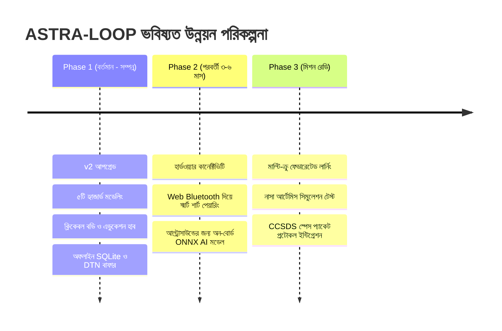

# ASTRA-LOOP: সীমাবদ্ধতা ও পরবর্তী ধাপ (Limitations & Roadmap)
> **নথি ক্রম:** ০৯ | **বিষয়:** প্রজেক্টের সৎ সীমাবদ্ধতা, ক্লিনিক্যাল সতর্কতা ও ভবিষ্যৎ পরিকল্পনা

---

## এই অংশে যা শিখবেন
* প্রজেক্টটিতে এই মুহূর্তে কী কী সীমাবদ্ধতা রয়েছে এবং কেন এটি কোনো সার্টিফাইড মেডিকেল ডিভাইস নয়।
* কোন কোন ক্লিনিক্যাল থ্রেশহোল্ডে বিশেষজ্ঞ চিকিৎসকের রিভিউ প্রয়োজন (`needsClinicalReview: true`)।
* নাসার প্রকৃত ফ্লাইট সার্জনদের কাছ থেকে আমাদের কী কী মতামত নেওয়া দরকার।
* ৩টি ধাপে প্রজেক্টটির ভবিষ্যৎ উন্নয়ন পরিকল্পনা (Roadmap)।

---

## ১. প্রজেক্টের বর্তমান সীমাবদ্ধতা (Honest Limitations)

বিচারক ও ইন্টারভিউয়ারদের সামনে একজন সৎ ইঞ্জিনিয়ার হিসেবে এই সীমাবদ্ধতাগুলো স্পষ্টভাবে তুলে ধরা আমাদের শক্তি:

### ১. ডেটা সিন্থেটিক (Synthetic Data Limitation)
* **বাস্তবতা:** অ্যাপে দেখানো ৯০ ও ১২০ দিনের অ্যাস্ট্রোনট ডেটা সম্পূর্ণ কৃত্রিমভাবে জেনারেট করা। নাসার টুইন স্টাডি এবং এলএসডিএ-র ডিস্ট্রিবিউশন অনুসরণ করা হলেও এটি আসল স্পেসক্রাফটের লাইভ বায়ো-সেন্সর ফিড নয়।
* **কোডে অবস্থান:** প্রতিটি ডেটাপয়েন্টে `isSynthetic: true` ফ্ল্যাগ বিদ্যমান।

### ২. ক্লিনিক্যাল রিভিউয়ের প্রয়োজনীয়তা (`needsClinicalReview`)
* **বাস্তবতা:** আমরা আন্তর্জাতিক গাইডলাইন (AHA, ADA, NASA-STD-3001) মেনে মান নির্ধারণ করেছি, তবে মহাকাশে চরম জিরো-গ্র্যাভিটিতে ওষুধ ও রক্তচাপের আচরণ সবসময় পৃথিবীর কার্ডিওলজির সাথে হুবহু নাও মিলতে পারে।
* **কোডে অবস্থান:** [`packages/shared/src/knowledge/indicators.ts`](file:///packages/shared/src/knowledge/indicators.ts) ফাইলে যেসব রেফারেন্স এখনো অ্যারোস্পেস চিকিৎসকের দ্বারা ভ্যালিডেট করা হয়নি, সেখানে `needsClinicalReview: true` ট্যাগ দেওয়া আছে।

### ৩. আল্ট্রাসাউন্ড ডায়াগনসিস স্বয়ংক্রিয় নয়
* **বাস্তবতা:** আমাদের `/routine` পেজের আল্ট্রাসাউন্ড স্ক্যানারে মহাকাশচারী ক্যানভাসে দাগ কেটে পৃথিবীতে পাঠাতে পারেন (Tele-ultrasound Annotator)। এটি এখনো কম্পিউটার ভিশন বা ডিপ লার্নিং দিয়ে নিজে থেকে রক্তের জমাট (DVT) বা অপটিক নার্ভের ফোলা স্বয়ংক্রিয়ভাবে শনাক্ত করে না।

### ৪. এটি কোনো সার্টিফাইড মেডিকেল ডিভাইস নয়
* **বাস্তবতা:** ASTRA-LOOP হলো একটি **ক্লিনিক্যাল ডিসিশন-সাপোর্ট সিস্টেম ও এডুকেশনাল প্রোটোটাইপ**। কোনো অবস্থাতেই এটি লাইসেন্সধারী ফ্লাইট সার্জনের বিকল্প নয়।

### ৫. হার্ডওয়্যার সেন্সর ইন্টিগ্রেশন
* **বাস্তবতা:** বর্তমান ভার্সনে সেন্সর ডেটা এপিআই ও ওয়েব ফরমের মাধ্যমে গ্রহণ করা হয়। সরাসরি ব্লুটুথ লো এনার্জি (BLE) দিয়ে রক্তচাপের কাফ বা স্মার্ট শার্টের সাথে ব্রাউজার পেয়ারিং এখনো বাস্তবায়নাধীন।

---

## ২. বিশেষজ্ঞ চিকিৎসকের কাছ থেকে যা যা যাচাই দরকার (Clinical Open Questions)

ভবিষ্যতে নাসা বা এয়ারোস্পেস মেডিসিনের বিশেষজ্ঞদের কাছে আমরা নিচের ৪টি প্রশ্ন উপস্থাপন করব:
1. **মার্স গ্র্যাভিটিতে ($0.38\text{ g}$) রক্তচাপের পরম সীমা:** জিরো-গ্র্যাভিটিতে সিস্টোলিক ১৪০ বিপদ হলেও, মঙ্গল গ্রহের এক-তৃতীয়াংশ অভিকর্ষে দীর্ঘমেয়াদে কোন রক্তচাপকে নিরাপদ ধরা হবে?
2. **রেডিয়েশন ও ঘুমের ইন্টারঅ্যাকশন পেনাল্টি:** আমাদের অ্যালগরিদমে ঘুমহীনতা ও রেডিয়েশনের সিনার্জিস্টিক ক্ষতিকে $০.০০১ \times (R_{\text{Sleep}} \times R_{\text{Rad}})$ সূত্রে ধরা হয়েছে। এই গুণকটি কি ক্লিনিক্যালি যথেষ্ট নাকি আরও বাড়ানো উচিত?
3. **ওষুধের শোষণ ক্ষমতা (Pharmacokinetics):** মহাকাশে লিভার ও অন্ত্রের রক্ত চলাচল কমে যাওয়ায় ব্যথানাশক বা মেলাটোনিন ট্যাবলেট শরীরে কতটা শোষিত হয় এবং এর ডোজ কি পরিবর্তন করতে হবে?
4. **SANS ডায়াগনসিসের অপটিক্যাল সীমা:** চোখের রেটিনার কোন সুনির্দিষ্ট পুরুত্বে ক্রুদের জরুরি স্টেরয়েড চিকিৎসা শুরু করা উচিত?

---

## ৩. ভবিষ্যৎ উন্নয়ন পরিকল্পনা (3-Phase Roadmap)

### Phase A: হার্ডওয়্যার পেয়ারিং ও রিয়েল-টাইম স্ট্রিমিং
* সরাসরি **Web Bluetooth API** ব্যবহার করে কমার্শিয়াল পোলার এইচ-১০ চেস্ট স্ট্র্যাপ এবং ডিজিটাল বিপি কাফের সাথে ব্রাউজার সংযুক্ত করা, যাতে মহাকাশচারীকে হাত দিয়ে কোনো টাইপ না করতে হয়।

### Phase B: অন-বোর্ড এজ কম্পিউটার ভিশন (Edge AI)
* আল্ট্রাসাউন্ড ইমেজ প্রসেসিংয়ের জন্য ব্রাউজারের ভেতরেই একটি লাইটওয়েট **ONNX / TensorFlow.js** মডেল চালানো, যা জিরো-গ্র্যাভিটিতে জুগুলার ভেইনের রক্ত জমাট (Thrombosis) ও চোখের নার্ভের ফোলা স্বয়ংক্রিয়ভাবে চিহ্নিত করতে পারবে।

### Phase C: মাল্টি-ক্রু মেশ নেটওয়ার্ক ও নাসা আর্টেমিস ভ্যালিডেশন
* একটি মহাকাশযানের ৪ জন মহাকাশচারীর আলাদা আলাদা ডিজিটাল টুইন একে অপরের সাথে ক্রু-কোহেশন ও ইনফেকশন ডেটা নিরাপদে শেয়ার করবে (Federated Mesh Learning)।
* নাসা জনসন স্পেস সেন্টারের অ্যানালগ মিশন (HERA বা CHAPEA) সিমুলেটরে বাস্তব ক্রুদের দিয়ে সফটওয়্যারটির ইউজার ট্রায়াল সম্পন্ন করা।

